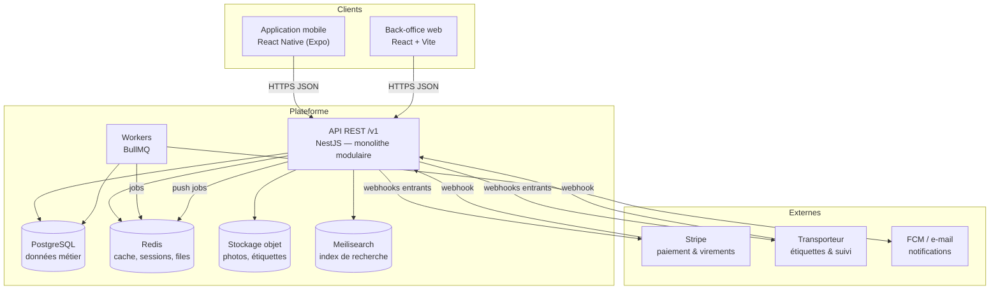
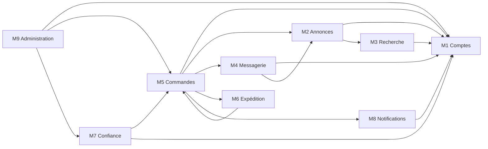
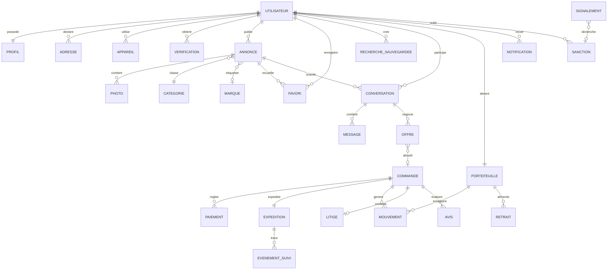
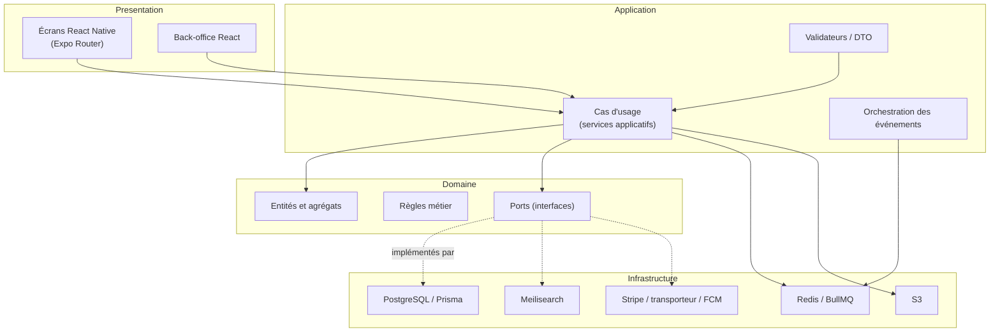
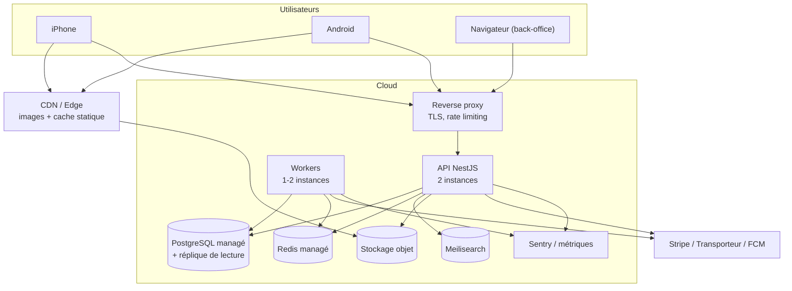
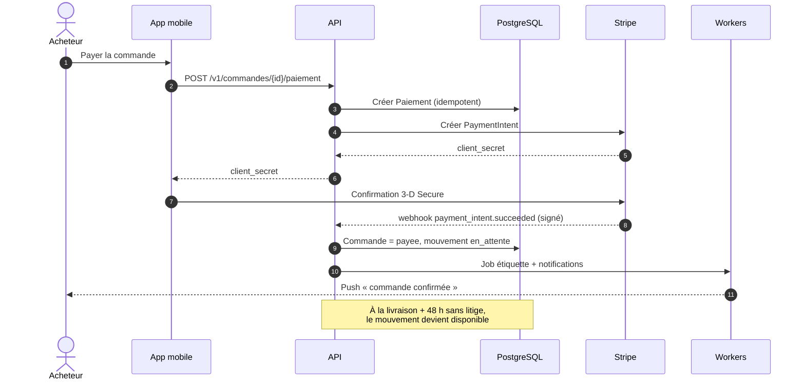

# SecondeVie

**Document d'architecture logicielle**

- **Version du document** : 1.0
- **Date** : 22 octobre 2026
- **Auteurs / équipe projet** : _à compléter_
- **Statut** : proposition initiale (MVP)

> « SecondeVie » est le nom de travail du projet. Il désigne une place de marché mobile
> de mode de seconde main, inspirée des usages de Vinted : publier une annonce en
> quelques minutes, négocier par messagerie, payer en sécurité et se faire livrer.

---

## Table des matières

1. [Contexte et objectifs](#1-contexte-et-objectifs)
2. [Exigences fonctionnelles et non fonctionnelles](#2-exigences-fonctionnelles-et-non-fonctionnelles-synthèse)
3. [Acteurs et vue d'utilisation](#3-acteurs-et-vue-dutilisation)
4. [Architecture globale du système](#4-architecture-globale-du-système)
5. [Conception des modules](#5-conception-des-modules)
6. [Vue globale du modèle d'information](#6-vue-globale-du-modèle-dinformation)
7. [Architecture applicative et technique](#7-architecture-applicative-et-technique)
8. [Sécurité et qualités techniques](#8-sécurité-et-qualités-techniques)
9. [Déploiement et environnements](#9-déploiement-et-environnements)
10. [Organisation du développement et gestion du code](#10-organisation-du-développement-et-gestion-du-code)
11. [Risques, limites et évolutions](#11-risques-limites-et-évolutions)
12. [Annexes](#12-annexes)

---

# 1. Contexte et objectifs

## 1.1 Contexte général

La mode est l'un des secteurs les plus polluants au monde, et la *fast fashion* a rendu
l'achat de vêtements peu cher mais rarement réutilisé. En parallèle, une part croissante
des 18-35 ans revend ses vêtements plutôt que de les jeter. Le marché de la seconde main
est donc devenu un réflexe, mais l'expérience reste frustrante :

- **Revendre est long et fastidieux** : prendre de bonnes photos, estimer un prix juste,
  répondre à des dizaines de messages, gérer les négociations, imprimer une étiquette.
- **Acheter manque de confiance** : l'état réel de l'article est difficile à vérifier,
  les contrefaçons circulent, et le paiement entre particuliers expose à l'arnaque.
- **Les solutions existantes sont incomplètes** : les plateformes généralistes
  (petites annonces) n'intègrent ni paiement sécurisé ni logistique ; les plateformes
  spécialisées imposent un parcours rigide, une commission opaque et peu d'outils de
  gestion pour le vendeur occasionnel.

Le projet **SecondeVie** propose une application mobile native qui couvre l'ensemble de
la chaîne : mise en ligne assistée, recherche pertinente, messagerie avec offres,
paiement sous séquestre, étiquette d'expédition prépayée, suivi, avis et modération.

## 1.2 Objectifs du système

1. **Publier une annonce en moins de 3 minutes** : photos guidées, catégorisation
   assistée, fourchettes de prix indicatives.
2. **Sécuriser la transaction** : paiement encaissé par la plateforme, libéré au vendeur
   seulement après confirmation de réception.
3. **Fluidifier la négociation** : messagerie temps réel et offres de prix structurées,
   horodatées et expirables, plutôt que des négociations par messages.
4. **Rendre la recherche réellement utile** : filtres métier (taille, marque, état,
   couleur), tri par pertinence et alertes de recherche.
5. **Installer la confiance** : avis liés à une commande réelle, vérification des
   comptes, modération des annonces et gestion des litiges.
6. **Donner au vendeur une vision claire de ses gains** : portefeuille, mouvements
   détaillés, demandes de virement.
7. **Rester exploitable par une petite équipe** : une base technique simple, un
   déploiement reproductible et une observabilité minimale dès le premier jour.

## 1.3 Périmètre de la version

**Inclus dans le MVP (v1.0)**

- Application mobile iOS et Android (React Native / Expo), en français, France métropolitaine.
- Compte membre unique (un même compte achète et vend), vérification e-mail et téléphone.
- Annonces : création, modification, suppression logique, photos, favoris, statuts.
- Recherche et filtres, fil personnalisé simple, alertes de recherche.
- Messagerie, offres de prix, blocage d'utilisateur.
- Commande, paiement par carte via Stripe, séquestre, portefeuille vendeur, virement SEPA.
- Expédition via un transporteur partenaire (étiquette prépayée, suivi).
- Avis post-commande, signalements, back-office de modération.
- Notifications push et e-mail transactionnelles.
- Back-office d'administration (web) : utilisateurs, annonces, litiges, paramètres.

**Explicitement hors périmètre**

- Version web publique et achat sans application.
- Expédition internationale et multi-devises.
- Paiement en plusieurs fois, crédit, abonnement premium.
- Recommandation par apprentissage automatique (v1 = règles et tri SQL).
- Authentification d'articles de luxe par expertise humaine.
- Enchères et ventes flash.

---

# 2. Exigences fonctionnelles et non fonctionnelles (synthèse)

## 2.1 Exigences fonctionnelles (vue macro)

| Réf. | Bloc fonctionnel | Contenu attendu |
|---|---|---|
| F1 | **Comptes et profils** | Inscription, connexion, vérification, profil public, adresses, préférences, suppression de compte |
| F2 | **Annonces** | Création guidée, photos, catégorie/marque/taille/état, prix, brouillon, publication, archivage |
| F3 | **Recherche et découverte** | Recherche plein texte, filtres, tri, favoris, fil d'accueil, alertes |
| F4 | **Messagerie et négociation** | Conversations liées à une annonce, messages, offres de prix, blocage |
| F5 | **Commande et paiement** | Création de commande, paiement, séquestre, frais, remboursement, portefeuille, virement |
| F6 | **Expédition** | Génération d'étiquette, dépôt, suivi, réception, retour |
| F7 | **Confiance** | Avis, signalements, sanctions, litiges, journal de modération |
| F8 | **Notifications** | Push, e-mail, in-app, préférences par type |
| F9 | **Administration** | Back-office, recherche d'utilisateurs, traitement des signalements, paramètres, exports |

## 2.2 Exigences non fonctionnelles

**Performance**

- API : temps de réponse **p95 < 300 ms** sur les lectures courantes, **p99 < 800 ms**.
- Recherche : résultats en **< 400 ms** pour un catalogue de 50 000 annonces actives.
- Images : affichage < 1,5 s sur 4G, variantes redimensionnées servies par CDN.
- Démarrage de l'application mobile : < 2,5 s sur un appareil milieu de gamme.
- Capacité cible du MVP : 5 000 utilisateurs actifs mensuels, 300 000 annonces, pic de
  50 requêtes/seconde.

**Sécurité**

- Authentification par JWT courte durée + refresh token rotatif, stocké dans le
  Keychain/Keystore de l'appareil.
- Mots de passe hachés avec **Argon2id**, jamais journalisés.
- Aucune donnée de carte bancaire stockée : délégation totale à Stripe (PCI-DSS).
- Contrôle d'accès par rôles et par propriété de ressource, vérifié côté serveur.
- Journal d'audit des actions sensibles (paiement, sanction, remboursement, export).
**Disponibilité et fiabilité**

- Disponibilité cible **99,5 %/mois** hors maintenance planifiée.
- Aucune perte de paiement : **idempotence** obligatoire sur la création de commande et
  le traitement des webhooks Stripe.
- Sauvegarde PostgreSQL quotidienne avec restauration testée mensuellement (RPO 24 h,
  RTO 4 h).
- File de messages persistante pour les traitements asynchrones (e-mails, push, suivi).

**Ergonomie / UX**

- Parcours d'annonce réalisable en 3 minutes, avec sauvegarde automatique du brouillon.
- Interface entièrement en français, formats de date et de prix localisés.
- Accessibilité minimale : contrastes WCAG AA, cibles tactiles ≥ 44 pt, libellés
  d'accessibilité sur les images et boutons.
- Gestion explicite des états hors ligne (brouillon local, reprise à la reconnexion).

**Conformité**

- RGPD : minimisation, durées de conservation documentées, export et suppression du
  compte, registre des traitements.
- **DAC7** : la plateforme doit déclarer aux impôts les vendeurs dépassant les seuils
  européens (30 transactions ou 2 000 € par an) — prévu dès la conception des données.
- Conditions générales d'utilisation et mentions légales accessibles depuis l'app.

---

# 3. Acteurs et vue d'utilisation

## 3.1 Acteurs du système

| Acteur | Rôle | Ce qu'il vient faire dans le système |
|---|---|---|
| **Visiteur** | Personne non authentifiée | Parcourir le catalogue public, consulter une annonce, s'inscrire |
| **Membre** | Utilisateur authentifié, acheteur et/ou vendeur | Publier, rechercher, négocier, acheter, vendre, suivre ses commandes |
| **Modérateur** | Agent interne | Traiter signalements, annonces douteuses, litiges, appliquer des sanctions |
| **Administrateur** | Responsable de la plateforme | Gérer les paramètres, les catégories, les comptes sensibles, les exports |
| **Transporteur** (externe) | Service logistique partenaire | Fournir les étiquettes et les événements de suivi (API/webhooks) |
| **Prestataire de paiement** (externe) | Stripe | Encaisser, reverser, rembourser, alimenter le portefeuille |
| **Service de notifications** (externe) | FCM / fournisseur e-mail | Acheminer push et e-mails transactionnels |

## 3.2 Scénarios d'usage principaux

**S1 — Publier une annonce**
1. Le membre choisit « Vendre », prend 3 à 8 photos (guidage de cadrage).
2. Il renseigne catégorie, marque, taille, état, couleur, puis un titre et une description.
3. L'application suggère une fourchette de prix à partir d'annonces comparables.
4. Il enregistre en brouillon ou publie ; l'annonce passe en revue automatique
   (contenu, doublons d'images) avant d'être visible.

**S2 — Acheter au prix affiché**
1. L'acheteur ouvre l'annonce, vérifie les mesures et l'état, choisit une adresse.
2. Il paie : le montant est capturé et conservé sous séquestre.
3. Le vendeur reçoit une notification, génère l'étiquette et dépose le colis.
4. À la livraison, l'acheteur confirme ; après 48 h sans litige, les fonds sont
   libérés sur le portefeuille du vendeur.

**S3 — Négocier puis acheter**
1. L'acheteur envoie une offre structurée (prix + expiration 48 h).
2. Le vendeur accepte, refuse ou contre-propose.
3. En cas d'acceptation, une commande est pré-créée et l'acheteur dispose de 24 h
   pour payer avant annulation automatique.
**S4 — Expédier une vente**
1. Le vendeur ouvre la commande, choisit un point de dépôt et un format de colis.
2. L'étiquette PDF est générée avec un numéro de suivi.
3. Il dépose le colis ; les événements de suivi sont ingérés par webhook.
4. À la livraison, la commande passe à « livrée » et le délai de confirmation démarre.

**S5 — Ouvrir un litige**
1. L'acheteur constate un article non conforme (taille, défaut, contrefaçon).
2. Il ouvre un litige dans les 48 h suivant la livraison, avec photos et description.
3. Le vendeur répond ; à défaut d'accord, un modérateur tranche.
4. Issue : remboursement total ou partiel, ou libération des fonds au vendeur.

**S6 — Modérer une annonce signalée**
1. Un membre signale une annonce (contrefaçon, article interdit, photos trompeuses).
2. Le signalement entre dans la file de modération, priorisé par risque.
3. Le modérateur masque, corrige ou refuse l'annonce ; la décision est motivée et
   journalisée, l'auteur est notifié.

## 3.3 User stories (optionnel)

- En tant que **membre**, je veux **publier une annonce depuis mon téléphone en moins de
  3 minutes** afin de **revendre sans y passer une soirée**.
- En tant qu'**acheteur**, je veux **filtrer par taille et marque** afin de **trouver la
  bonne pièce sans parcourir des centaines d'annonces**.
- En tant qu'**acheteur**, je veux **payer dans l'application** afin de **ne pas risquer
  un virement à un inconnu**.
- En tant que **vendeur**, je veux **recevoir une étiquette prépayée** afin de **ne pas
  avancer les frais de port**.
- En tant que **vendeur**, je veux **suivre mon solde et demander un virement** afin de
  **savoir quand je serai payé**.
- En tant qu'**acheteur**, je veux **recevoir une alerte quand une annonce correspond à
  ma recherche** afin de **ne pas rater une pièce rare**.
- En tant que **modérateur**, je veux **voir l'historique d'un compte et de ses
  signalements** afin de **décider d'une sanction de façon cohérente**.
- En tant qu'**administrateur**, je veux **exporter les données de vente annuelles**
  afin de **respecter l'obligation DAC7**.

---

# 4. Architecture globale du système

## 4.1 Vue d'ensemble

L'application mobile est le point d'entrée unique du membre. Elle dialogue avec une API
HTTP unique, qui concentre la logique métier et s'appuie sur des services spécialisés
pour la recherche, le stockage de fichiers, le cache, les traitements asynchrones et les
intégrations externes. Un back-office web consomme la même API avec des rôles dédiés.



**Décomposition en blocs**

| Bloc | Technologie | Responsabilité |
|---|---|---|
| Interface mobile | React Native + Expo, TypeScript | Parcours membre, cache local, notifications |
| Interface back-office | React + Vite, TypeScript | Modération, support, paramétrage |
| API applicative | NestJS (Node.js 22), TypeScript | Expose les cas d'usage métier, autorise, valide |
| Base relationnelle | PostgreSQL 16 | Source de vérité transactionnelle |
| Cache / files | Redis 7 | Cache de lecture, rate limiting, files BullMQ |
| Recherche | Meilisearch | Index dénormalisé des annonces publiées |
| Fichiers | S3 compatible (MinIO en local) | Photos d'annonces, étiquettes PDF, exports |
| Workers | Node.js + BullMQ | E-mails, push, indexation, relances, exports |
| Paiement | Stripe Connect | Encaissement, séquestre logique, reversements |
| Logistique | API transporteur partenaire | Étiquettes, suivi, retours |

## 4.2 Principes d'architecture

**Style architectural : monolithe modulaire.**
Une seule application déployable, découpée en modules à frontières explicites
(`comptes`, `annonces`, `recherche`, `messagerie`, `commandes`, `expedition`,
`confiance`, `notifications`, `admin`). Chaque module possède son domaine, son schéma de
données et son API interne ; il ne peut lire les tables d'un autre module que via son
service. Ce choix offre la simplicité opérationnelle d'un monolithe tout en préparant une
extraction ultérieure (le module `recherche` ou `notifications` sont les premiers
candidats).

**Règles de dépendance**

- Le sens des dépendances va de l'interface vers le domaine, jamais l'inverse.
- Un module ne dépend jamais d'un autre module par ses tables, seulement par un service
  exposé ou un événement.
- Les intégrations externes (Stripe, transporteur, FCM) sont derrière des *ports*
  (interfaces) et des *adaptateurs*, remplaçables en test.

**Communication**

- **Synchrone** : REST/JSON versionné (`/v1`), pour les parcours utilisateur.
- **Asynchrone interne** : événements de domaine persistés dans une table *outbox*, puis
  publiés dans BullMQ (fiabilité « au moins une fois », consommateurs idempotents).
- **Entrant externe** : webhooks signés (Stripe, transporteur), vérifiés puis mis en file
  avant traitement.

**Principes transverses**

1. Séparation stricte présentation / application / domaine / infrastructure.
2. Validation systématique des entrées (schémas) et erreurs normalisées.
3. Idempotence sur toute opération financière ou d'expédition.
4. Aucune vérité métier calculée côté mobile (le client propose, le serveur décide).
5. Traçabilité : chaque changement d'état d'une commande est horodaté et attribué.
6. Configuration par variables d'environnement (12-factor), aucun secret dans le dépôt.

---

# 5. Conception des modules

Cette section est le cœur du document : pour chaque module sont décrits son rôle, ses
fonctionnalités, ses entités et attributs, ses interfaces, ses flux, ses dépendances et
ses règles métier.

## 5.1 Vue d'ensemble des modules

| Module | Description en une phrase |
|---|---|
| **M1 — Comptes et identité** | Gère les membres, leurs profils, adresses, appareils et vérifications. |
| **M2 — Annonces et catalogue** | Porte les articles mis en vente, leurs photos et les référentiels (catégories, marques, tailles). |
| **M3 — Recherche et découverte** | Indexe les annonces publiées et fournit recherche, filtres, favoris et alertes. |
| **M4 — Messagerie et négociation** | Organise les conversations liées aux annonces et les offres de prix. |
| **M5 — Commandes et paiements** | Transforme une intention d'achat en commande payée, sécurisée et réglée au vendeur. |
| **M6 — Expédition et logistique** | Produit les étiquettes, suit les colis et gère les retours. |
| **M7 — Confiance et modération** | Porte les avis, signalements, sanctions, litiges et le journal de modération. |
| **M8 — Notifications** | Diffuse les événements métier vers le push, l'e-mail et le centre de notifications. |
| **M9 — Administration et pilotage** | Fournit le back-office, les paramètres système, l'audit et les exports. |



> Les flèches indiquent « dépend de » au sens service, pas « lit les tables de ».

## 5.2 Description détaillée des modules

### 5.2.1 M1 — Comptes et identité

**1. Rôle et responsabilité du module**

Garantir l'identité des membres et la cohérence de leurs informations personnelles. Il
est la seule source de vérité sur « qui est l'utilisateur » : état du compte, coordonnées
vérifiées, préférences, adresses postales et appareils autorisés. Aucun autre module ne
crée ni ne modifie un utilisateur.

**2. Fonctionnalités prises en charge**

- Inscription par e-mail (ou Apple/Google), connexion, déconnexion, réinitialisation.
- Vérification de l'e-mail et du numéro de téléphone.
- Consultation et modification du profil public (pseudo, avatar, bio, mensurations).
- Gestion des adresses de livraison et de facturation, avec adresse par défaut.
- Gestion des appareils connectés et des jetons de notification.
- Suppression du compte (anonymisation) et export des données personnelles.
- Consultation des sanctions actives (lecture seule, alimentée par M7).

**3. Entités du module**

**Utilisateur** — le compte membre, support de l'authentification.

| Attribut | Type / Format | Description métier | Contraintes |
|---|---|---|---|
| `id` | UUID v4 | Identifiant unique du compte | Clé primaire, immuable |
| `email` | Texte (254) | Identifiant de connexion | Unique, normalisé en minuscules, format validé |
| `telephone` | Texte E.164 | Numéro de contact | Unique s'il est renseigné |
| `mot_de_passe_hash` | Texte | Empreinte Argon2id | Obligatoire si pas d'OAuth, jamais exposé |
| `pseudo` | Texte (3-30) | Nom affiché publiquement | Unique, sans espaces, insensible à la casse |
| `nom_complet` | Texte (120) | Identité légale (facturation, litiges) | Privé, obligatoire avant le premier virement |
| `date_naissance` | Date | Contrôle d'âge | ≥ 18 ans, privé |
| `pays` | Code ISO 3166-1 | Pays de résidence | Défaut « FR » en v1 |
| `statut` | Enum | État du compte | `actif`, `restreint`, `suspendu`, `supprime` |
| `role` | Enum | Rôle principal | `membre`, `moderateur`, `admin` |
| `email_verifie_le` | Date/heure | Preuve de vérification | Nullable |
| `telephone_verifie_le` | Date/heure | Preuve de vérification | Nullable |
| `note_moyenne` | Décimal (2,1) | Moyenne des avis reçus | 0 à 5, recalculée par M7 |
| `nb_ventes` / `nb_achats` | Entier | Compteurs d'activité | Dénormalisé, recalculé par lots |
| `cree_le` / `maj_le` | Date/heure | Traçabilité | Automatique |
| `derniere_connexion_le` | Date/heure | Dernière authentification réussie | Nullable |

**Profil** — informations publiques et préférences d'affichage.

| Attribut | Type / Format | Description métier | Contraintes |
|---|---|---|---|
| `id` | UUID | Identifiant | Clé primaire |
| `utilisateur_id` | UUID | Compte propriétaire | Unique, FK vers `Utilisateur` |
| `avatar_url` | URL | Photo de profil | Optionnel, image validée |
| `bio` | Texte (300) | Présentation libre | Modérée à la publication |
| `taille_cm` | Entier | Taille vestimentaire déclarée | 120 à 230 |
| `pointure` | Entier | Pointure déclarée | 15 à 50 |
| `styles_preferes` | Liste d'énumérés | Affinités (streetwear, vintage…) | Max 5 valeurs |
| `visibilite_profil` | Enum | Qui voit le profil | `public`, `membres` |
| `langue` | Code ISO 639-1 | Langue de l'interface | `fr` par défaut |

**Adresse** — destination de livraison ou adresse de facturation.

| Attribut | Type / Format | Description métier | Contraintes |
|---|---|---|---|
| `id` | UUID | Identifiant | Clé primaire |
| `utilisateur_id` | UUID | Propriétaire | FK, index |
| `libelle` | Texte (40) | Nom court (« Maison ») | Obligatoire |
| `destinataire` | Texte (120) | Nom sur l'étiquette | Obligatoire |
| `ligne1` / `ligne2` | Texte (120) | Voie et complément | `ligne1` obligatoire |
| `code_postal` / `ville` | Texte | Localisation | Validés selon le pays |
| `pays` | Code ISO | Pays | `FR` en v1 |
| `telephone` | E.164 | Contact transporteur | Obligatoire |
| `est_defaut` | Booléen | Adresse présélectionnée | Une seule par utilisateur |
| `supprimee_le` | Date/heure | Suppression logique | Les commandes passées la conservent |
**Appareil** — session persistante et canal de notification.

| Attribut | Type / Format | Description métier | Contraintes |
|---|---|---|---|
| `id` | UUID | Identifiant de l'appareil | Clé primaire |
| `utilisateur_id` | UUID | Propriétaire | FK, index |
| `plateforme` | Enum | Système d'exploitation | `ios`, `android`, `web` |
| `device_id` | Texte | Identifiant stable fourni par l'app | Unique par utilisateur |
| `refresh_token_hash` | Texte | Empreinte du jeton de rafraîchissement | Rotation à chaque usage |
| `push_token` | Texte | Jeton FCM | Nullable, mis à jour à chaque ouverture |
| `derniere_activite_le` | Date/heure | Dernier usage | Sert à purger les sessions |
| `revoque_le` | Date/heure | Déconnexion forcée | Nullable |

**Verification** — preuve d'e-mail, de téléphone ou d'identité renforcée.

| Attribut | Type / Format | Description métier | Contraintes |
|---|---|---|---|
| `id` | UUID | Identifiant | Clé primaire |
| `utilisateur_id` | UUID | Compte concerné | FK |
| `type` | Enum | Nature de la preuve | `email`, `telephone`, `identite` |
| `statut` | Enum | Avancement | `en_attente`, `valide`, `refuse`, `expire` |
| `fournisseur_ref` | Texte | Référence externe (KYC) | Nullable |
| `code_hash` | Texte | Code à usage unique haché | Jamais stocké en clair |
| `tentatives` | Entier | Nombre d'essais | Max 5, puis blocage 1 h |
| `expire_le` | Date/heure | Validité du code | 15 min |
| `valide_le` | Date/heure | Horodatage de la preuve | Nullable |

**4. Interfaces exposées par le module**

| Interface | Type | Accès | Finalité |
|---|---|---|---|
| `POST /v1/auth/inscription` | REST | Écriture | Créer un compte et envoyer le code e-mail |
| `POST /v1/auth/connexion` | REST | Écriture | Obtenir un couple access/refresh token |
| `POST /v1/auth/refresh` | REST | Écriture | Renouveler l'access token (rotation) |
| `POST /v1/auth/deconnexion` | REST | Écriture | Révoquer l'appareil courant |
| `POST /v1/auth/mot-de-passe/reinitialiser` | REST | Écriture | Envoi du lien de réinitialisation |
| `GET /v1/moi` | REST | Lecture | Profil privé + préférences + sanctions |
| `PATCH /v1/moi` | REST | Écriture | Mise à jour du profil |
| `GET /v1/moi/adresses` | REST | Lecture | Liste des adresses |
| `POST /v1/moi/adresses` | REST | Écriture | Ajouter une adresse |
| `DELETE /v1/moi/adresses/{id}` | REST | Écriture | Supprimer (logique) une adresse |
| `GET /v1/utilisateurs/{pseudo}` | REST | Lecture | Profil public + annonces en vente |
| `DELETE /v1/moi` | REST | Écriture | Demande de suppression de compte |
| `compte.cree`, `compte.supprime` | Événements | Émission | Notifier M8 et M9 |

**5. Flux fonctionnels principaux**

*Inscription et première connexion*

1. L'app envoie e-mail, pseudo, mot de passe et date de naissance ; l'API valide,
   vérifie l'unicité et crée `Utilisateur` (statut `actif`) + `Profil`.
2. Un code à 6 chiffres est généré, haché, stocké dans `Verification`, puis envoyé par
   M8. L'utilisateur dispose de 15 minutes et de 5 tentatives.
3. À la validation, `email_verifie_le` est renseigné ; un appareil et ses jetons sont
   créés, l'utilisateur entre dans l'application.
4. L'événement `compte.cree` déclenche l'e-mail de bienvenue et l'initialisation du
   portefeuille (M5).

*Suppression de compte*

1. Demande explicite avec confirmation par mot de passe.
2. Refus si une commande est en cours, un litige ouvert ou un solde non nul.
3. Anonymisation : e-mail remplacé par une valeur technique, profil vidé, annonces
   archivées, appareils révoqués ; les données comptables et les avis sont conservés
   sous forme pseudonymisée (obligation légale).

**6. Dépendances vers d'autres modules**

| Module | Usage |
|---|---|
| M7 — Confiance | Lire les sanctions actives et la note moyenne ; recevoir les décisions |
| M8 — Notifications | Envoyer codes de vérification, e-mails de sécurité, alertes de connexion |
| M9 — Administration | Exposer la recherche d'utilisateurs et les actions de support |

**7. Règles métier et contraintes spécifiques**

- Un e-mail = un compte ; la casse et les espaces sont normalisés avant l'unicité.
- Un compte non vérifié ne peut ni publier ni acheter ; la navigation reste possible.
- Le passage à `suspendu` révoque immédiatement tous les refresh tokens.
- Une adresse utilisée par une commande ne peut être supprimée que logiquement.
- Les champs `nom_complet`, `date_naissance` et `telephone` sont obligatoires avant le
  premier virement (KYC léger imposé par le prestataire de paiement).
- Toute modification d'e-mail ou de mot de passe déclenche une notification de sécurité.

### 5.2.2 M2 — Annonces et catalogue

**1. Rôle et responsabilité du module**

Porter l'offre : ce qu'un membre met en vente, avec ses photos, ses caractéristiques et son
prix. Il garantit qu'une annonce est complète, conforme aux règles de publication et
cohérente avec les référentiels du catalogue. Il ne gère ni la recherche (M3), ni la
transaction (M5).

**2. Fonctionnalités prises en charge**

- Création guidée d'annonce : photos, catégorie, marque, taille, état, couleur, prix.
- Brouillon auto-sauvegardé, republication d'une annonce archivée.
- Gestion des statuts : `brouillon`, `en_revue`, `publiee`, `reservee`, `vendue`,
  `archivee`, `refusee`.
- Téléversement et ordonnancement des photos, suppression, choix de la photo principale.
- Favoris (ajout/retrait, comptage) et compteurs de vues.
- Modération automatique à la publication (doublons d'images, mots interdits) et
  passage en revue humaine sur signalement.
- Référentiels : catégories hiérarchiques, marques, grilles de tailles.

**3. Entités du module**

**Annonce** — l'article proposé à la vente.

| Attribut | Type / Format | Description métier | Contraintes |
|---|---|---|---|
| `id` | UUID | Identifiant | Clé primaire |
| `reference` | Texte (12) | Référence lisible (« SV-8F3K2A ») | Unique, générée |
| `vendeur_id` | UUID | Membre qui vend | FK `Utilisateur`, obligatoire |
| `titre` | Texte (80) | Intitulé affiché | 5 à 80 caractères, sans majuscules abusives |
| `description` | Texte (2000) | Détail, défauts, mesures | 20 à 2000 caractères |
| `categorie_id` | UUID | Catégorie feuille | FK, obligatoire |
| `marque_id` | UUID | Marque | FK, nullable (« non précisée ») |
| `taille` | Texte (12) | Taille portée | Obligatoire hors accessoires |
| `etat` | Enum | État déclaré | `neuf_avec_etiquette`, `neuf_sans_etiquette`, `tres_bon`, `bon`, `satisfaisant` |
| `couleur` | Texte (30) | Couleur dominante | Liste contrôlée + « autre » |
| `matiere` | Texte (60) | Composition déclarée | Optionnel |
| `prix_cents` | Entier | Prix demandé | 100 à 500 000 (1 € à 5 000 €) |
| `prix_origine_cents` | Entier | Prix neuf indicatif | Optionnel, ≥ `prix_cents` |
| `devise` | Code ISO 4217 | Devise | `EUR` en v1 |
| `poids_g` | Entier | Poids pour le port | 50 à 30 000 |
| `statut` | Enum | État de vie de l'annonce | Voir liste ci-dessus |
| `motif_refus` | Texte (300) | Raison d'un refus | Obligatoire si `refusee` |
| `nb_vues` | Entier | Compteur d'affichages | Dénormalisé, incrémenté par lots |
| `nb_favoris` | Entier | Compteur de favoris | Dénormalisé |
| `cree_le` / `publiee_le` / `maj_le` | Date/heure | Traçabilité | `publiee_le` nullable |

**Photo** — image rattachée à une annonce.

| Attribut | Type / Format | Description métier | Contraintes |
|---|---|---|---|
| `id` | UUID | Identifiant | Clé primaire |
| `annonce_id` | UUID | Annonce parente | FK, index |
| `url_originale` | URL | Fichier source | Bucket privé, accès signé |
| `url_variantes` | JSON | Tailles générées (S/M/L) | Produites par worker |
| `ordre` | Entier | Position d'affichage | 0 = photo principale |
| `largeur` / `hauteur` | Entier | Dimensions | Contrôle du ratio |
| `percept_hash` | Texte | Empreinte perceptuelle | Détection de doublons |
| `statut_moderation` | Enum | Résultat automatique | `ok`, `a_verifier`, `refusee` |
| `cree_le` | Date/heure | Date d'ajout | Automatique |

**Categorie** — nœud de l'arborescence du catalogue.

| Attribut | Type / Format | Description métier | Contraintes |
|---|---|---|---|
| `id` | UUID | Identifiant | Clé primaire |
| `parent_id` | UUID | Catégorie mère | Nullable, max 3 niveaux |
| `nom` | Texte (60) | Libellé affiché | Unique sous un même parent |
| `slug` | Texte (60) | Identifiant lisible | Unique global |
| `niveau` | Entier | Profondeur (0 à 2) | Cohérent avec `parent_id` |
| `taille_obligatoire` | Booléen | Exige une taille | Faux pour accessoires |
| `actif` | Booléen | Ouverte à la publication | Désactivation sans suppression |
| `ordre` | Entier | Tri d'affichage | ≥ 0 |
**Marque** — référentiel des marques proposées.

| Attribut | Type / Format | Description métier | Contraintes |
|---|---|---|---|
| `id` | UUID | Identifiant | Clé primaire |
| `nom` | Texte (80) | Nom affiché | Unique, insensible à la casse |
| `slug` | Texte (80) | Identifiant lisible | Unique |
| `logo_url` | URL | Logo (CDN) | Optionnel |
| `verifiee` | Booléen | Marque validée par l'équipe | Faux par défaut |
| `actif` | Booléen | Proposable à la saisie | Désactivation possible |

**Favori** — mise de côté d'une annonce par un membre.

| Attribut | Type / Format | Description métier | Contraintes |
|---|---|---|---|
| `id` | UUID | Identifiant | Clé primaire |
| `utilisateur_id` | UUID | Membre | FK |
| `annonce_id` | UUID | Annonce mise de côté | FK |
| `cree_le` | Date/heure | Date d'ajout | Automatique |

**ReferentielTaille** — correspondance des tailles par catégorie et système.

| Attribut | Type / Format | Description métier | Contraintes |
|---|---|---|---|
| `id` | UUID | Identifiant | Clé primaire |
| `categorie_id` | UUID | Famille concernée | FK |
| `systeme` | Enum | Grille utilisée | `EU`, `UK`, `US`, `FR`, `universel` |
| `libelle` | Texte (12) | Valeur affichée (« M », « 38 ») | Unique par catégorie/système |
| `equivalent_cm` | Entier | Mesure indicative | Nullable |
| `ordre` | Entier | Tri croissant | ≥ 0 |

**4. Interfaces exposées par le module**

| Interface | Type | Accès | Finalité |
|---|---|---|---|
| `POST /v1/annonces` | REST | Écriture | Créer un brouillon |
| `PATCH /v1/annonces/{id}` | REST | Écriture | Modifier une annonce (propriétaire) |
| `POST /v1/annonces/{id}/photos` | REST | Écriture | Obtenir une URL de téléversement signée |
| `DELETE /v1/annonces/{id}/photos/{photoId}` | REST | Écriture | Supprimer une photo |
| `POST /v1/annonces/{id}/publier` | REST | Écriture | Passer en revue puis publier |
| `POST /v1/annonces/{id}/archiver` | REST | Écriture | Retirer de la vente |
| `GET /v1/annonces/{id}` | REST | Lecture | Détail public |
| `GET /v1/moi/annonces` | REST | Lecture | Annonces du membre, tous statuts |
| `POST /v1/annonces/{id}/favori` | REST | Écriture | Ajouter un favori |
| `DELETE /v1/annonces/{id}/favori` | REST | Écriture | Retirer un favori |
| `GET /v1/referentiels/categories` | REST | Lecture | Arborescence complète |
| `GET /v1/referentiels/marques?q=` | REST | Lecture | Autocomplétion |
| `annonce.publiee`, `annonce.vendue`, `annonce.archivee` | Événements | Émission | Alimenter M3, M8, M9 |

**5. Flux fonctionnels principaux**

*Publication d'une annonce*

1. `POST /v1/annonces` crée le brouillon ; l'app enregistre localement puis synchronise.
2. Chaque photo est téléversée directement vers S3 via une URL signée, puis confirmée ;
   un worker génère les variantes et l'empreinte perceptuelle.
3. `POST /publier` vérifie les champs obligatoires, le nombre de photos (≥ 1), la
   cohérence du prix et l'absence de doublon visuel ; l'annonce passe `en_revue`.
4. Si les contrôles automatiques sont bons : `publiee`, événement émis, indexation M3.
   Sinon : `refusee` (motif) ou mise en file de modération humaine.

*Vente d'une annonce*

1. M5 notifie `annonce.reservee` dès qu'une commande est payée.
2. L'annonce sort des résultats de recherche mais reste consultable par les deux parties.
3. À la clôture de la commande : `vendue` ; en cas d'annulation : retour à `publiee`.

**6. Dépendances vers d'autres modules**

| Module | Usage |
|---|---|
| M1 — Comptes | Vérifier le statut du vendeur, sa note, son quota d'annonces |
| M3 — Recherche | Indexer, réindexer, retirer une annonce |
| M7 — Confiance | Recevoir les refus de modération et les suspensions |
| M8 — Notifications | Prévenir le vendeur (publication, refus, vente) |

**7. Règles métier et contraintes spécifiques**

- Maximum **20 annonces actives** par membre en v1 (anti-spam), extensible par rôle.
- Une annonce doit avoir **au moins une photo** et **au plus 12**.
- Le prix est exprimé en centimes, entier, jamais en flottant.
- Une annonce `reservee` ne peut plus être modifiée (prix et photos verrouillés).
- La suppression est logique : les commandes passées doivent rester consultables.
- Un article interdit (contrefaçon, arme, produit illégal) est refusé et peut entraîner
  une sanction prononcée par M7.
- Les tailles sont contraintes par `ReferentielTaille` lorsque
  `Categorie.taille_obligatoire` est vrai.

### 5.2.3 M3 — Recherche et découverte

**1. Rôle et responsabilité du module**

Rendre le catalogue trouvable et désirable. Il maintient une projection dénormalisée des
annonces publiées (index plein texte + filtres à facettes), sert la recherche, le fil
d'accueil, les favoris, les alertes et les compteurs d'interaction utiles au tri.

**2. Fonctionnalités prises en charge**

- Recherche plein texte tolérante aux fautes (titre, description, marque, catégorie).
- Filtres : catégorie, marque, taille, état, couleur, fourchette de prix, pays.
- Tris : pertinence, prix croissant/décroissant, nouveauté.
- Pagination par curseur (jamais par `OFFSET` sur l'index).
- Fil d'accueil : nouveautés, redécouvertes, annonces proches des préférences.
- Favoris et recherche sauvegardée avec alerte (fréquence quotidienne).
- Journal d'interactions (vue, clic, favori) pour le tri et les statistiques vendeur.

**3. Entités du module**

**DocumentAnnonce** — projection d'indexation (non relationnelle, source de vérité = M2).

| Attribut | Type / Format | Description métier | Contraintes |
|---|---|---|---|
| `id` | UUID | Identifiant de l'annonce | Identique à `Annonce.id` |
| `titre` / `description` | Texte | Contenu indexé | Copie à l'indexation |
| `categorie` / `sous_categorie` | Texte | Libellés à facettes | Recalculés à chaque mise à jour |
| `marque` | Texte | Marque normalisée | Nullable |
| `taille` / `etat` / `couleur` | Texte | Filtres | Valeurs contrôlées |
| `prix_cents` | Entier | Tri et filtre | ≥ 0 |
| `vendeur_id` | UUID | Filtrage par vendeur | — |
| `photo_principale` | URL | Vignette de résultat | CDN |
| `publiee_le` | Date/heure | Tri par nouveauté | — |
| `score_popularite` | Décimal | Tri secondaire | Vues + favoris pondérés |
| `statut` | Enum | Visibilité | Seules les `publiee` sont indexées |

**RechercheSauvegardee** — critères mémorisés et alerte associée.

| Attribut | Type / Format | Description métier | Contraintes |
|---|---|---|---|
| `id` | UUID | Identifiant | Clé primaire |
| `utilisateur_id` | UUID | Propriétaire | FK |
| `libelle` | Texte (60) | Nom donné (« Jean Levi's 501 W30 ») | Obligatoire |
| `criteres` | JSON | Requête et filtres sérialisés | Validés par schéma |
| `alerte_active` | Booléen | Envoi d'alertes | Faux par défaut |
| `frequence` | Enum | Rythme des alertes | `immediate`, `quotidienne` |
| `derniere_alerte_le` | Date/heure | Anti-doublon | Nullable |
| `cree_le` | Date/heure | Date de création | Automatique |

**Interaction** — trace d'usage pour le tri et les statistiques.

| Attribut | Type / Format | Description métier | Contraintes |
|---|---|---|---|
| `id` | UUID (ou ULID) | Identifiant | Clé primaire |
| `utilisateur_id` | UUID | Membre (nullable si visiteur) | FK |
| `annonce_id` | UUID | Annonce concernée | FK |
| `type` | Enum | Nature | `vue`, `clic`, `favori`, `partage`, `achat` |
| `contexte` | JSON | Origine (recherche, fil, lien) | Optionnel |
| `cree_le` | Date/heure | Horodatage | Partitionné par mois |

**4. Interfaces exposées par le module**

| Interface | Type | Accès | Finalité |
|---|---|---|---|
| `GET /v1/recherche?q=&filtres=&tri=&curseur=` | REST | Lecture | Recherche paginée |
| `GET /v1/recherche/facettes?q=` | REST | Lecture | Compteurs par filtre |
| `GET /v1/fil` | REST | Lecture | Fil d'accueil personnalisé |
| `GET /v1/moi/favoris` | REST | Lecture | Favoris du membre |
| `POST /v1/recherches` | REST | Écriture | Sauvegarder une recherche |
| `PATCH /v1/recherches/{id}` | REST | Écriture | Activer/désactiver l'alerte |
| `DELETE /v1/recherches/{id}` | REST | Écriture | Supprimer |
| `POST /v1/interactions` | REST | Écriture | Journaliser une vue ou un clic (lot) |
| `annonce.*` | Événements | Consommation | Mettre à jour l'index |

**5. Flux fonctionnels principaux**

*Indexation*

1. M2 émet `annonce.publiee` ou `annonce.maj`.
2. Un worker consomme l'événement, lit l'annonce et ses relations, construit le
   `DocumentAnnonce` et l'envoie à Meilisearch (upsert idempotent).
3. En cas de `annonce.archivee` / `vendue`, le document est supprimé de l'index.

*Recherche et alerte*

1. L'app appelle `/v1/recherche` avec texte, filtres et curseur.
2. Le module interroge l'index, applique les filtres de visibilité (vendeur non
   suspendu) et renvoie résultats + curseur suivant.
3. Si le membre a sauvegardé la recherche avec alerte, un job quotidien rejoue la requête,
   compare aux annonces déjà notifiées et déclenche un push groupé.

**6. Dépendances vers d'autres modules**

| Module | Usage |
|---|---|
| M1 — Comptes | Exclure les vendeurs suspendus, lire les préférences de style |
| M2 — Annonces | Source des documents indexés |
| M8 — Notifications | Envoyer les alertes de recherche |
| M9 — Administration | Statistiques de recherche, réindexation complète |

**7. Règles métier et contraintes spécifiques**

- Seules les annonces `publiee` sont visibles ; une annonce `reservee` disparaît des
  résultats au plus tard 60 s après l'événement.
- L'index est une projection : en cas de divergence, M2 fait foi et une réindexation
  complète est déclenchable depuis l'administration.
- Les alertes sont plafonnées à **une par recherche et par jour**.
- Aucune donnée personnelle (e-mail, téléphone, adresse) n'entre dans l'index.

### 5.2.4 M4 — Messagerie et négociation

**1. Rôle et responsabilité du module**

Permettre aux membres de se parler et de négocier proprement, sans sortir de la
plateforme. Il garantit que chaque conversation est rattachée à une annonce, que les
offres de prix sont structurées et horodatées, et que les échanges restent modérables
(signalement, blocage, preuve en cas de litige).

**2. Fonctionnalités prises en charge**

- Création d'une conversation à partir d'une annonce (un acheteur ↔ un vendeur).
- Messages texte, images, messages système (offre, acceptation, commande liée).
- Offres de prix structurées : montant, expiration, acceptation, refus, contre-offre.
- Accusés de lecture, compteur de non-lus, indicateur de saisie.
- Archivage, blocage d'utilisateur, signalement d'un message.
- Recherche dans ses conversations, pièces jointes limitées aux images.
- Interdiction de partage de coordonnées (filtre anti-contournement).

**3. Entités du module**

**Conversation** — fil d'échange entre deux membres autour d'une annonce.

| Attribut | Type / Format | Description métier | Contraintes |
|---|---|---|---|
| `id` | UUID | Identifiant | Clé primaire |
| `annonce_id` | UUID | Annonce concernée | FK, une conversation par couple (annonce, acheteur) |
| `acheteur_id` | UUID | Membre acheteur | FK, ≠ `vendeur_id` |
| `vendeur_id` | UUID | Membre vendeur | FK, dénormalisé depuis l'annonce |
| `statut` | Enum | État du fil | `active`, `archivee`, `bloquee`, `fermee` |
| `dernier_message_le` | Date/heure | Tri de la boîte de réception | Indexé |
| `dernier_message_extrait` | Texte (140) | Aperçu | Tronqué, sans image |
| `nb_non_lus_acheteur` / `_vendeur` | Entier | Compteurs | Remis à zéro à l'ouverture |
| `cree_le` | Date/heure | Ouverture | Automatique |

**Message** — unité de contenu d'une conversation.

| Attribut | Type / Format | Description métier | Contraintes |
|---|---|---|---|
| `id` | UUID | Identifiant | Clé primaire, ordonnable |
| `conversation_id` | UUID | Fil parent | FK, index composé avec `cree_le` |
| `auteur_id` | UUID | Expéditeur (ou `systeme`) | FK, nullable pour les messages système |
| `type` | Enum | Nature | `texte`, `image`, `offre`, `systeme` |
| `contenu` | Texte (2000) | Texte brut | Filtré (coordonnées, insultes) |
| `image_url` | URL | Pièce jointe | Bucket privé, accès signé |
| `offre_id` | UUID | Offre liée | Obligatoire si `type = offre` |
| `livre_le` | Date/heure | Remise (accusé) | Nullable |
| `lu_le` | Date/heure | Lecture par le destinataire | Nullable |
| `supprime_le` | Date/heure | Suppression côté client | Masqué pour tous, conservé pour litige |
| `cree_le` | Date/heure | Envoi | Automatique |

**Offre** — proposition de prix structurée.

| Attribut | Type / Format | Description métier | Contraintes |
|---|---|---|---|
| `id` | UUID | Identifiant | Clé primaire |
| `conversation_id` | UUID | Fil d'origine | FK |
| `annonce_id` | UUID | Annonce négociée | FK |
| `auteur_id` | UUID | Proposeur | FK (acheteur ou vendeur en contre-offre) |
| `montant_cents` | Entier | Prix proposé | ≥ 100, ≤ prix affiché en 1re offre |
| `statut` | Enum | Cycle de vie | `en_attente`, `acceptee`, `refusee`, `contre_offre`, `expiree`, `annulee` |
| `offre_parente_id` | UUID | Contre-offre d'origine | Nullable |
| `expire_le` | Date/heure | Fin de validité | 48 h après création |
| `decidee_le` | Date/heure | Acceptation/refus | Nullable |
| `commande_id` | UUID | Commande issue de l'offre | Nullable, renseigné par M5 |

**Blocage** — relation unilatérale empêchant les échanges et les achats.

| Attribut | Type / Format | Description métier | Contraintes |
|---|---|---|---|
| `id` | UUID | Identifiant | Clé primaire |
| `utilisateur_id` | UUID | Auteur du blocage | FK |
| `cible_id` | UUID | Membre bloqué | FK, ≠ `utilisateur_id` |
| `motif` | Enum | Raison | `harcelement`, `arnaque`, `desaccord`, `autre` |
| `cree_le` | Date/heure | Date du blocage | Automatique |
**4. Interfaces exposées par le module**

| Interface | Type | Accès | Finalité |
|---|---|---|---|
| `POST /v1/conversations` | REST | Écriture | Ouvrir (ou retrouver) un fil pour une annonce |
| `GET /v1/conversations` | REST | Lecture | Boîte de réception triée |
| `GET /v1/conversations/{id}/messages?curseur=` | REST | Lecture | Historique paginé |
| `POST /v1/conversations/{id}/messages` | REST | Écriture | Envoyer un message (idempotent par clé client) |
| `POST /v1/conversations/{id}/lecture` | REST | Écriture | Marquer comme lu |
| `POST /v1/conversations/{id}/offres` | REST | Écriture | Créer une offre / contre-offre |
| `POST /v1/offres/{id}/accepter` | REST | Écriture | Acceptation (appelée par M5) |
| `POST /v1/offres/{id}/refuser` | REST | Écriture | Refus explicite |
| `POST /v1/blocages` | REST | Écriture | Bloquer un membre |
| `DELETE /v1/blocages/{id}` | REST | Écriture | Débloquer |
| `message.cree`, `offre.acceptee` | Événements | Émission | Push temps réel, création de commande |

**5. Flux fonctionnels principaux**

*Négociation jusqu'à la commande*

1. L'acheteur ouvre une conversation depuis une annonce et envoie une offre à 18 € pour
   un article affiché à 22 €, valable 48 h.
2. Le vendeur reçoit un push ; il peut accepter, refuser ou contre-proposer à 20 €.
3. En cas d'acceptation : `offre.acceptee` est émis, l'annonce est réservée et M5 crée
   une commande à 18 € + frais. L'acheteur a **24 h** pour payer, sinon la commande est
   annulée et l'annonce republiée.
4. Toute la chronologie (offres, réponses) reste attachée à la conversation et sert de
   preuve en cas de litige.

*Temps réel*

1. L'app ouvre une connexion WebSocket authentifiée (ou bascule en *polling* court si
   l'OS la coupe).
2. Chaque message est d'abord persisté en base, puis publié sur le canal de la
   conversation ; l'expéditeur reçoit son identifiant définitif.

**6. Dépendances vers d'autres modules**

| Module | Usage |
|---|---|
| M1 — Comptes | Vérifier le statut des participants et les blocages |
| M2 — Annonces | Vérifier l'annonce, la réserver à l'acceptation |
| M5 — Commandes | Créer la commande issue d'une offre acceptée |
| M7 — Confiance | Signaler un message, fournir les preuves d'un litige |
| M8 — Notifications | Push de nouveau message, d'offre et de décision |

**7. Règles métier et contraintes spécifiques**

- Une seule conversation par couple (annonce, acheteur) ; rouvrir renvoie le fil existant.
- Un membre bloqué ne peut plus écrire, offrir ni acheter ; le blocage est réciproque
  pour l'achat.
- Une offre ne peut pas dépasser le prix affiché lors de la première proposition.
- Une offre acceptée **verrouille** l'annonce ; elle expire si le paiement n'intervient
  pas sous 24 h.
- Le contenu est filtré : e-mails, numéros de téléphone, liens de paiement externes et
  IBAN sont masqués et signalés.
- Les messages supprimés restent accessibles aux modérateurs en cas de litige, jamais au
  membre.

### 5.2.5 M5 — Commandes et paiements

**1. Rôle et responsabilité du module**

Transformer une intention d'achat en transaction financière sûre. Il crée la commande,
calcule les frais, encaisse via Stripe, conserve les fonds sous séquestre, libère le
vendeur après réception, gère les remboursements, le portefeuille et les virements. Il
est la seule source de vérité sur « qui doit combien à qui ».

**2. Fonctionnalités prises en charge**

- Création de commande au prix affiché ou après acceptation d'une offre.
- Calcul des frais : commission acheteur, frais de port, net vendeur.
- Paiement par carte (Stripe PaymentIntent), 3-D Secure, idempotence.
- Séquestre : capture immédiate, disponibilité différée au vendeur.
- Annulation, remboursement total ou partiel, litige.
- Portefeuille vendeur : solde disponible, solde en attente, historique.
- Demandes de virement SEPA et suivi de leur statut.
- Machines à états strictes et journalisation de chaque transition.
**3. Entités du module**

**Commande** — engagement d'achat entre deux membres.

| Attribut | Type / Format | Description métier | Contraintes |
|---|---|---|---|
| `id` | UUID | Identifiant | Clé primaire |
| `reference` | Texte (12) | Référence lisible | Unique, non devinable |
| `annonce_id` / `annonce_snapshot` | UUID / JSON | Article et copie des données au moment de l'achat | Immuable après création |
| `acheteur_id` / `vendeur_id` | UUID | Parties | FK, distincts |
| `offre_id` | UUID | Offre d'origine | Nullable (achat direct) |
| `montant_article_cents` | Entier | Prix négocié ou affiché | > 0 |
| `frais_service_cents` | Entier | Commission acheteur | Calculée, jamais saisie |
| `frais_port_cents` | Entier | Affranchissement | Grille transporteur |
| `total_cents` | Entier | Somme payée | = article + service + port |
| `net_vendeur_cents` | Entier | Montant crédité | = article − commission vendeur |
| `devise` | ISO 4217 | Devise | `EUR` |
| `statut` | Enum | État courant | `en_attente_paiement`, `payee`, `expediee`, `livree`, `terminee`, `litige`, `annulee`, `remboursee` |
| `adresse_livraison_snapshot` | JSON | Adresse figée | Immuable |
| `delai_confirmation_le` | Date/heure | Fin du délai de 48 h | Calculé à la livraison |
| `cree_le` / `payee_le` / `livree_le` / `terminee_le` | Date/heure | Jalons | Nullables |

**Paiement** — tentative d'encaissement liée à une commande.

| Attribut | Type / Format | Description métier | Contraintes |
|---|---|---|---|
| `id` | UUID | Identifiant | Clé primaire |
| `commande_id` | UUID | Commande réglée | FK |
| `fournisseur` | Enum | Prestataire | `stripe` en v1 |
| `intent_ref` | Texte | Référence PaymentIntent | Unique |
| `montant_cents` | Entier | Montant capturé | = `Commande.total_cents` |
| `statut` | Enum | État | `cree`, `autorise`, `capture`, `echoue`, `rembourse` |
| `moyen` | Texte (20) | Marque de carte (visa, cb…) | Jamais le PAN |
| `code_echec` | Texte (40) | Motif normalisé | Nullable |
| `idempotency_key` | Texte (64) | Clé client | Unique par tentative |
| `cree_le` / `capture_le` | Date/heure | Horodatage | — |
**Portefeuille** — compte de solde du vendeur.

| Attribut | Type / Format | Description métier | Contraintes |
|---|---|---|---|
| `id` | UUID | Identifiant | Clé primaire |
| `utilisateur_id` | UUID | Propriétaire | Unique, FK |
| `solde_disponible_cents` | Entier | Retirable immédiatement | ≥ 0, jamais négatif |
| `solde_en_attente_cents` | Entier | Séquestre en cours | ≥ 0 |
| `devise` | ISO 4217 | Devise | `EUR` |
| `stripe_account_id` | Texte | Compte connecté | Créé à la première vente |
| `maj_le` | Date/heure | Dernière écriture | Automatique |

**MouvementPortefeuille** — écriture comptable immuable (grand livre).

| Attribut | Type / Format | Description métier | Contraintes |
|---|---|---|---|
| `id` | UUID | Identifiant | Clé primaire |
| `portefeuille_id` | UUID | Portefeuille | FK |
| `commande_id` | UUID | Commande liée | Nullable (ajustement) |
| `type` | Enum | Nature | `vente`, `commission`, `remboursement`, `retrait`, `ajustement` |
| `montant_cents` | Entier signé | Crédit (+) ou débit (−) | ≠ 0 |
| `statut` | Enum | Comptabilisation | `en_attente`, `disponible`, `annule` |
| `disponible_le` | Date/heure | Date de libération | Nullable |
| `libelle` | Texte (120) | Description lisible | Généré |
| `cree_le` | Date/heure | Écriture | Immuable |

**Retrait** — demande de virement vers un compte bancaire.

| Attribut | Type / Format | Description métier | Contraintes |
|---|---|---|---|
| `id` | UUID | Identifiant | Clé primaire |
| `portefeuille_id` | UUID | Portefeuille débité | FK |
| `montant_cents` | Entier | Montant demandé | ≥ 100 (1 €), ≤ solde disponible |
| `iban_masque` | Texte | IBAN partiel affiché | Les 4 derniers chiffres seulement |
| `statut` | Enum | Avancement | `demandee`, `en_cours`, `payee`, `echouee`, `annulee` |
| `transfer_ref` | Texte | Référence Stripe | Nullable |
| `motif_echec` | Texte (200) | Raison | Nullable |
| `demandee_le` / `executee_le` | Date/heure | Jalons | — |

**Litige** — désaccord sur une commande (porté par M7, stocké ici pour la transaction).

| Attribut | Type / Format | Description métier | Contraintes |
|---|---|---|---|
| `id` | UUID | Identifiant | Clé primaire |
| `commande_id` | UUID | Commande contestée | FK, un litige ouvert par commande |
| `ouvert_par` | UUID | Membre plaignant | FK |
| `motif` | Enum | Catégorie | `non_recu`, `non_conforme`, `contrefacon`, `casse`, `autre` |
| `description` | Texte (2000) | Exposé | Obligatoire |
| `statut` | Enum | État | `ouvert`, `instruction`, `resolu_acheteur`, `resolu_vendeur`, `clos` |
| `resolution` | Enum | Issue | `remboursement_total`, `remboursement_partiel`, `aucun` |
| `montant_rembourse_cents` | Entier | Montant rendu | ≤ `total_cents` |
| `cree_le` / `clos_le` | Date/heure | Jalons | — |
**4. Interfaces exposées par le module**

| Interface | Type | Accès | Finalité |
|---|---|---|---|
| `POST /v1/commandes` | REST | Écriture | Créer une commande (depuis une annonce ou une offre) |
| `GET /v1/commandes/{id}` | REST | Lecture | Détail (parties et modérateurs uniquement) |
| `GET /v1/moi/commandes?role=achat\|vente` | REST | Lecture | Listes par rôle |
| `POST /v1/commandes/{id}/paiement` | REST | Écriture | Créer le PaymentIntent |
| `POST /v1/commandes/{id}/annuler` | REST | Écriture | Annulation avant expédition |
| `POST /v1/commandes/{id}/confirmer-reception` | REST | Écriture | Clôture anticipée du délai |
| `GET /v1/moi/portefeuille` | REST | Lecture | Soldes et derniers mouvements |
| `GET /v1/moi/portefeuille/mouvements?curseur=` | REST | Lecture | Grand livre paginé |
| `POST /v1/moi/retraits` | REST | Écriture | Demander un virement |
| `POST /v1/webhooks/stripe` | Webhook | Écriture | Événements de paiement signés |
| `commande.payee`, `commande.livree`, `fonds.disponibles` | Événements | Émission | Alimenter M6, M7, M8 |

**5. Flux fonctionnels principaux**

*Achat et séquestre*

1. `POST /commandes` fige un `annonce_snapshot` et calcule les frais ; statut
   `en_attente_paiement`, annonce réservée, expiration à 24 h.
2. `POST /paiement` crée un PaymentIntent (clé d'idempotence = commande + tentative).
3. Le webhook `payment_intent.succeeded` (signature vérifiée) passe la commande en
   `payee`, enregistre `Paiement.capture` et crédite le **solde en attente** du vendeur.
4. M6 génère l'étiquette ; le vendeur expédie ; la commande suit son cycle jusqu'à
   `livree`.
5. À `livree`, `delai_confirmation_le = maintenant + 48 h`. Sans litige à échéance, la
   commande passe `terminee` et le mouvement devient `disponible`.

*Remboursement*

1. Décision de M7 (litige) ou annulation avant expédition.
2. Remboursement Stripe total ou partiel ; écritures inverses dans le grand livre ;
   commande `remboursee` ; annonce éventuellement republiée.

**6. Dépendances vers d'autres modules**

| Module | Usage |
|---|---|
| M1 — Comptes | Identité des parties, adresse figée, KYC avant virement |
| M2 — Annonces | Vérifier la disponibilité, réserver, republier |
| M4 — Messagerie | Offre acceptée, preuves de négociation |
| M6 — Expédition | Déclencher l'étiquette, recevoir la livraison, gérer les retours |
| M7 — Confiance | Litiges, sanctions, remboursements décidés |
| M8 — Notifications | Confirmation, expédition, livraison, paiement, virement |
| M9 — Administration | Support, remboursement manuel, exports comptables |

**7. Règles métier et contraintes spécifiques**

- **Commission acheteur : 5 % + 0,70 €**, arrondie au centime supérieur ; **0 % côté
  vendeur** en v1 (net vendeur = prix de l'article). Paramétrable par M9.
- Aucun montant n'est calculé côté client ; le serveur recalcule tout.
- Une commande non payée est annulée automatiquement à **24 h**.
- L'argent n'est jamais disponible avant la livraison + 48 h (ou confirmation explicite).
- Un vendeur ne peut pas retirer plus que son solde disponible ; un seul retrait en cours
  à la fois.
- Toute opération financière est idempotente : rejouer un webhook ne double jamais une
  écriture (clé unique `fournisseur + intent_ref + statut`).
- Le grand livre est **append-only** : une correction est un nouveau mouvement, jamais
  une modification.
- Un litige ouvert gèle la libération des fonds de la commande concernée.

### 5.2.6 M6 — Expédition et logistique

**1. Rôle et responsabilité du module**

Faire arriver le colis. Il choisit un service de livraison cohérent avec le poids et la
destination, produit une étiquette prépayée, ingère les événements de suivi du
transporteur et expose un état de livraison fiable à M5, M7 et M8.

**2. Fonctionnalités prises en charge**

- Devis de transport au moment de la commande (poids, format, destination).
- Génération d'étiquette PDF/QR et d'un numéro de suivi.
- Sélection d'un point de retrait ou d'une livraison à domicile.
- Ingestion des événements de suivi par webhook (normalisés en codes internes).
- Détection des anomalies : colis bloqué, retour à l'expéditeur, adresse invalide.
- Retours : étiquette retour, réception, remboursement associé (avec M5).
- Rattachement des preuves (photo de dépôt) en cas de litige.

**3. Entités du module**

**Expedition** — colis associé à une commande.

| Attribut | Type / Format | Description métier | Contraintes |
|---|---|---|---|
| `id` | UUID | Identifiant | Clé primaire |
| `commande_id` | UUID | Commande concernée | FK, une expédition active par commande |
| `transporteur` | Enum | Prestataire | `mondial_relay`, `colissimo`, `chronopost`… |
| `service` | Texte (30) | Niveau de service | Détermine le délai |
| `numero_suivi` | Texte (40) | Référence transporteur | Unique |
| `etiquette_url` | URL | PDF ou QR | Accès signé, expirant |
| `poids_g` | Entier | Poids facturé | Cohérent avec l'annonce (± 10 %) |
| `format` | Enum | Gabarit | `S`, `M`, `L` |
| `statut` | Enum | État logistique | `a_etiqueter`, `etiquete`, `depose`, `en_transit`, `livre`, `retour`, `perdu` |
| `depose_le` / `livre_le` | Date/heure | Jalons | Nullables |

**EvenementSuivi** — événement brut normalisé du transporteur.

| Attribut | Type / Format | Description métier | Contraintes |
|---|---|---|---|
| `id` | UUID | Identifiant | Clé primaire |
| `expedition_id` | UUID | Colis | FK, index |
| `code` | Enum | Code interne normalisé | `pris_en_charge`, `en_transit`, `en_livraison`, `livre`, `retour`, `incident` |
| `libelle_source` | Texte (200) | Libellé transporteur | Conservé tel quel |
| `source_id` | Texte (60) | Identifiant d'événement | Unique par transporteur (déduplication) |
| `survenu_le` | Date/heure | Date réelle de l'événement | Peut précéder la réception |
| `recu_le` | Date/heure | Date d'ingestion | Automatique |

**PointRetrait** — point de proximité proposé à l'acheteur.

| Attribut | Type / Format | Description métier | Contraintes |
|---|---|---|---|
| `id` | Texte (40) | Identifiant transporteur | Clé primaire composite avec `transporteur` |
| `transporteur` | Enum | Réseau | — |
| `nom` | Texte (120) | Enseigne | — |
| `adresse` | JSON | Adresse complète | — |
| `latitude` / `longitude` | Décimal | Géolocalisation | Précision 5 décimales |
| `horaires` | JSON | Ouverture par jour | Tronqué à 7 entrées |
| `actif` | Booléen | Encore proposé | Rafraîchi quotidiennement |
**4. Interfaces exposées par le module**

| Interface | Type | Accès | Finalité |
|---|---|---|---|
| `POST /v1/expeditions/devis` | REST | Lecture | Prix et délais pour un colis |
| `POST /v1/commandes/{id}/expedition` | REST | Écriture | Créer l'expédition et l'étiquette |
| `GET /v1/commandes/{id}/expedition` | REST | Lecture | État et suivi |
| `GET /v1/points-retrait?lat=&lng=&rayon=` | REST | Lecture | Points proches |
| `POST /v1/webhooks/transporteur` | Webhook | Écriture | Événements de suivi signés |
| `POST /v1/expeditions/{id}/retour` | REST | Écriture | Générer un retour |
| `expedition.livree`, `expedition.incident` | Événements | Émission | M5, M7, M8 |

**5. Flux fonctionnels principaux**

*Étiquette et dépôt*

1. À la commande payée, M5 appelle le devis avec poids, format et destination.
2. Le vendeur choisit le service et le point de dépôt ; M6 appelle l'API transporteur,
   stocke l'étiquette dans S3 et le `numero_suivi`.
3. Le vendeur imprime ou présente le QR en point relais ; le premier événement
   `pris_en_charge` fait passer l'expédition et la commande en `expediee`.

*Suivi et livraison*

1. Le transporteur pousse des événements signés ; M6 déduplique par `source_id`,
   normalise le code et met à jour `statut`.
2. À `livre`, M5 fixe le délai de confirmation de 48 h et M8 notifie l'acheteur.
3. À défaut de confirmation et sans litige, la clôture libère les fonds.

**6. Dépendances vers d'autres modules**

| Module | Usage |
|---|---|
| M1 — Comptes | Adresse figée de la commande, téléphone |
| M5 — Commandes | Déclenchement, statut de la commande, retours et remboursements |
| M7 — Confiance | Preuves de dépôt/livraison pour instruire un litige |
| M8 — Notifications | Alertes d'expédition, de livraison et d'incident |
| M9 — Administration | Suivi des incidents, réédition d'étiquette, paramétrage transporteurs |

**7. Règles métier et contraintes spécifiques**

- Une seule expédition active par commande ; une réédition d'étiquette remplace la
  précédente (l'ancienne est invalidée).
- Le poids facturé ne peut pas s'écarter de plus de 10 % du poids déclaré ; au-delà, un
  complément de port est facturé au vendeur (règle paramétrable).
- Un événement de suivi ne fait jamais régresser un statut (`livre` reste `livre`).
- Un incident bloque la libération des fonds et ouvre une tâche de support.
- Les étiquettes contiennent des données personnelles : URL signée, expiration 7 jours,
  aucune indexation publique.

### 5.2.7 M7 — Confiance et modération

**1. Rôle et responsabilité du module**

Protéger les membres et la place de marché. Il porte les avis vérifiés, les signalements,
les décisions de modération, les sanctions et l'instruction des litiges. Il garantit
qu'aucune décision n'est prise sans trace et que chaque sanction est proportionnée et
révocable.

**2. Fonctionnalités prises en charge**

- Avis liés à une commande terminée, avec note et commentaire.
- Signalements d'annonces, de messages, de profils et de commandes.
- File de modération priorisée par risque, avec assignation et délais cibles.
- Sanctions : avertissement, restriction de publication, suspension, bannissement.
- Instruction des litiges et décision (remboursement total, partiel, ou aucun).
- Calcul de la note moyenne et du taux de litige par membre.
- Journal de modération inaltérable (qui, quoi, quand, pourquoi).

**3. Entités du module**

**Avis** — retour d'expérience rattaché à une commande réelle.

| Attribut | Type / Format | Description métier | Contraintes |
|---|---|---|---|
| `id` | UUID | Identifiant | Clé primaire |
| `commande_id` | UUID | Commande justifiant l'avis | FK, un avis par auteur et par commande |
| `auteur_id` / `cible_id` | UUID | Rédacteur et destinataire | FK, distincts |
| `note` | Entier (1-5) | Évaluation globale | Obligatoire |
| `commentaire` | Texte (1000) | Texte libre | Optionnel, modéré |
| `statut` | Enum | Visibilité | `publie`, `masque`, `en_revue` |
| `reponse_vendeur` | Texte (600) | Réponse unique du vendeur | Optionnelle, 30 jours max |
| `cree_le` | Date/heure | Publication | Automatique |

**Signalement** — alerte émise par un membre ou par un contrôle automatique.

| Attribut | Type / Format | Description métier | Contraintes |
|---|---|---|---|
| `id` | UUID | Identifiant | Clé primaire |
| `signaleur_id` | UUID | Auteur (nullable si automatique) | FK |
| `cible_type` | Enum | Nature de la cible | `annonce`, `message`, `utilisateur`, `commande` |
| `cible_id` | UUID | Identifiant de la cible | Polymorphe, indexé |
| `motif` | Enum | Catégorie | `contrefacon`, `article_interdit`, `arnaque`, `harcelement`, `contenu_sexuel`, `spam`, `autre` |
| `description` | Texte (1000) | Explication | Obligatoire si `autre` |
| `preuves` | JSON | URLs d'images ou messages | Max 5 |
| `priorite` | Entier (1-3) | Risque | 1 = critique (contrefaçon, mineur) |
| `statut` | Enum | Traitement | `nouveau`, `en_cours`, `traite`, `rejete`, `doublon` |
| `traite_par` | UUID | Modérateur | FK |
| `decision` | Texte (500) | Motif de la décision | Obligatoire à la clôture |
| `cree_le` / `traite_le` | Date/heure | Jalons | — |
**Sanction** — mesure appliquée à un membre.

| Attribut | Type / Format | Description métier | Contraintes |
|---|---|---|---|
| `id` | UUID | Identifiant | Clé primaire |
| `utilisateur_id` | UUID | Membre sanctionné | FK, index |
| `type` | Enum | Nature | `avertissement`, `restriction_publication`, `suspension`, `bannissement` |
| `motif` | Enum | Référence au motif du signalement | Obligatoire |
| `commentaire` | Texte (500) | Explication communiquée | Obligatoire |
| `signalement_id` | UUID | Signalement déclencheur | Nullable (contrôle interne) |
| `debut_le` / `fin_le` | Date/heure | Période | `fin_le` nul = permanent |
| `decidee_par` | UUID | Modérateur | FK |
| `levee_le` / `levee_par` | Date/heure, UUID | Levée anticipée | Nullables |
| `cree_le` | Date/heure | Création | Immuable |

**JournalModeration** — trace inaltérable de chaque action.

| Attribut | Type / Format | Description métier | Contraintes |
|---|---|---|---|
| `id` | UUID | Identifiant | Clé primaire |
| `acteur_id` | UUID | Modérateur ou admin | FK |
| `action` | Enum | Action réalisée | `masquer_annonce`, `refuser_annonce`, `sanctionner`, `lever_sanction`, `trancher_litige`, `repondre_signalement` |
| `cible_type` / `cible_id` | Enum, UUID | Objet de l'action | — |
| `details` | JSON | Avant/après, motif, paramètres | Jamais de données sensibles inutiles |
| `adresse_ip` | Texte (45) | Origine de l'action | IPv4/IPv6 |
| `cree_le` | Date/heure | Horodatage | Immuable, pas de mise à jour possible |

**4. Interfaces exposées par le module**

| Interface | Type | Accès | Finalité |
|---|---|---|---|
| `POST /v1/commandes/{id}/avis` | REST | Écriture | Déposer un avis (acheteur ou vendeur) |
| `GET /v1/utilisateurs/{id}/avis?curseur=` | REST | Lecture | Avis publics d'un membre |
| `POST /v1/avis/{id}/reponse` | REST | Écriture | Réponse du vendeur |
| `POST /v1/signalements` | REST | Écriture | Signaler un contenu |
| `GET /v1/admin/signalements?statut=&priorite=` | REST | Lecture | File de modération |
| `POST /v1/admin/signalements/{id}/decision` | REST | Écriture | Clore avec décision |
| `POST /v1/admin/utilisateurs/{id}/sanctions` | REST | Écriture | Appliquer une sanction |
| `POST /v1/admin/sanctions/{id}/lever` | REST | Écriture | Lever une sanction |
| `POST /v1/admin/litiges/{id}/decision` | REST | Écriture | Trancher un litige |
| `membre.sanctionne`, `litige.resolu` | Événements | Émission | M1, M5, M8 |

**5. Flux fonctionnels principaux**

*Signalement et sanction*

1. Un membre signale une annonce pour contrefaçon ; priorité 1, preuves jointes.
2. La file de modération affiche le signalement, l'historique du compte et les
   signalements similaires.
3. Le modérateur masque l'annonce, notifie le vendeur et applique, si nécessaire, un
   avertissement ou une suspension.
4. Tout est journalisé ; l'auteur du signalement reçoit une confirmation générique
   (sans détail sur la sanction, par confidentialité).

*Litige*

1. L'acheteur ouvre un litige depuis la commande, dans les 48 h après livraison.
2. Les fonds restent gelés ; les deux parties déposent leurs preuves (photos, messages).
3. Le modérateur tranche : remboursement total, partiel, ou libération au vendeur.
4. M5 exécute la décision ; les deux parties sont notifiées avec le motif.

**6. Dépendances vers d'autres modules**

| Module | Usage |
|---|---|
| M1 — Comptes | Statut, historique, note ; appliquer une suspension |
| M2 — Annonces | Masquer ou refuser une annonce |
| M4 — Messagerie | Lire les échanges comme preuve (accès restreint) |
| M5 — Commandes | Geler/libérer des fonds, rembourser |
| M8 — Notifications | Informer les parties des décisions |
| M9 — Administration | Statistiques de modération, politique et seuils |

**7. Règles métier et contraintes spécifiques**

- Un avis n'existe que si la commande est `terminee` ; un avis par auteur et par commande.
- La note d'un membre est la moyenne de ses **12 derniers** avis publiés.
- Un signalement ne peut être déposé deux fois par le même membre sur la même cible.
- Toute sanction d'une durée > 7 jours doit être motivée et révisable sur demande.
- Le journal de modération est **append-only** ; une correction crée une nouvelle entrée.
- Un modérateur ne peut pas instruire un litige auquel il participe en tant que membre.

### 5.2.8 M8 — Notifications

**1. Rôle et responsabilité du module**

Acheminer les événements métier vers le bon canal, au bon membre, sans doublon ni
inondation. Il centralise les modèles de messages, les préférences, les tentatives
d'envoi et l'historique consultable depuis l'application.

**2. Fonctionnalités prises en charge**

- Notifications push (FCM), e-mail transactionnel et centre de notifications in-app.
- Modèles versionnés par code (`commande.payee`, `message.nouveau`, `litige.resolu`…).
- Préférences par catégorie (commandes, messages, marketing, alertes de recherche).
- Regroupement (*digest*) et fenêtre de silence (22 h – 8 h par défaut).
- Réessais avec repli exponentiel, journal des échecs et désactivation des jetons morts.
- Journalisation des envois pour le support et la conformité.

**3. Entités du module**

**Notification** — instance d'un message destiné à un membre.

| Attribut | Type / Format | Description métier | Contraintes |
|---|---|---|---|
| `id` | UUID | Identifiant | Clé primaire |
| `utilisateur_id` | UUID | Destinataire | FK, index |
| `code_modele` | Texte (60) | Modèle utilisé | Référence `ModeleMessage.code` |
| `canal` | Enum | Voie d'envoi | `push`, `email`, `in_app` |
| `titre` / `corps` | Texte | Contenu rendu | 60 / 200 caractères (push) |
| `donnees` | JSON | Payload de navigation (deep link) | Sans données sensibles |
| `statut` | Enum | Avancement | `en_attente`, `envoyee`, `echouee`, `lue` |
| `tentatives` | Entier | Nombre d'essais | Max 5 |
| `derniere_erreur` | Texte (200) | Motif normalisé | Nullable |
| `envoyee_le` / `lue_le` | Date/heure | Jalons | Nullables |
| `cree_le` | Date/heure | Création | Automatique |

**PreferenceNotification** — réglages du membre par catégorie.

| Attribut | Type / Format | Description métier | Contraintes |
|---|---|---|---|
| `id` | UUID | Identifiant | Clé primaire |
| `utilisateur_id` | UUID | Membre | FK |
| `categorie` | Enum | Famille | `commande`, `message`, `offre`, `recherche`, `moderation`, `marketing` |
| `push_actif` | Booléen | Autorisation push | Défaut selon catégorie |
| `email_actif` | Booléen | Autorisation e-mail | Transactions toujours vraies |
| `heure_silence_debut` / `_fin` | Heure | Plage sans push | 22:00 – 08:00 |

**ModeleMessage** — gabarit de contenu versionné.

| Attribut | Type / Format | Description métier | Contraintes |
|---|---|---|---|
| `id` | UUID | Identifiant | Clé primaire |
| `code` | Texte (60) | Clé technique | Unique |
| `canal` | Enum | Canal cible | `push`, `email`, `in_app` |
| `langue` | Code ISO | Langue | `fr` en v1 |
| `sujet` | Texte (120) | Objet (e-mail) | Obligatoire pour `email` |
| `corps` | Texte | Gabarit avec variables `{{…}}` | Variables validées |
| `version` | Entier | Version courante | Incrémentée, jamais réécrite |
| `actif` | Booléen | Envoi autorisé | Faux = journalisé sans envoi |

**4. Interfaces exposées par le module**

| Interface | Type | Accès | Finalité |
|---|---|---|---|
| `GET /v1/moi/notifications?curseur=` | REST | Lecture | Centre de notifications |
| `POST /v1/moi/notifications/{id}/lu` | REST | Écriture | Marquer comme lue |
| `GET /v1/moi/preferences-notifications` | REST | Lecture | Préférences |
| `PUT /v1/moi/preferences-notifications` | REST | Écriture | Mettre à jour |
| `POST /v1/moi/appareils/push-token` | REST | Écriture | Enregistrer/renouveler le jeton |
| `*.evenement` (interne) | Jobs | Consommation | Rendre et envoyer |

**5. Flux fonctionnels principaux**

*Envoi d'une notification*

1. Un module émet un événement de domaine (`commande.payee`).
2. M8 sélectionne les modèles du canal, rend les variables, vérifie les préférences et
   la plage de silence, puis crée une `Notification` `en_attente`.
3. Un worker envoie via FCM ou le fournisseur e-mail ; succès → `envoyee`, échec →
   réessai avec repli (1 min, 5 min, 30 min…), puis `echouee`.
4. Un jeton FCM invalide est désactivé sur l'appareil concerné.

*Digest d'alertes*

1. Les alertes de recherche sont accumulées pendant 24 h.
2. Un job quotidien groupe les annonces par recherche et envoie un seul push.

**6. Dépendances vers d'autres modules**

| Module | Usage |
|---|---|
| M1 — Comptes | Appareils, jetons push, langue |
| M3 — Recherche | Contenu des alertes |
| M5 / M6 / M7 | Événements métier à notifier |

**7. Règles métier et contraintes spécifiques**

- Les notifications **transactionnelles** (paiement, expédition, sécurité) ne peuvent pas
  être désactivées par e-mail ; seul le push l'est.
- Une notification n'est jamais envoyée deux fois pour le même événement (clé
  d'idempotence = événement + membre + canal).
- Aucune donnée personnelle sensible dans le payload push (pas de montant de carte, pas
  d'adresse complète).
- Les jetons push sont purgés après 90 jours d'inactivité.

### 5.2.9 M9 — Administration et pilotage

**1. Rôle et responsabilité du module**

Donner à l'équipe les moyens d'exploiter la plateforme : back-office de modération et de
support, paramétrage sans redéploiement, audit, exports réglementaires et indicateurs.
Il ne porte aucune logique métier propre : il délègue aux modules concernés.

**2. Fonctionnalités prises en charge**

- Back-office web : recherche multi-critères (membre, annonce, commande, signalement).
- Actions de support : réédition d'étiquette, remboursement manuel, déblocage, note
  interne.
- Paramétrage : commissions, seuils, transporteurs actifs, catégories, marques.
- Drapeaux de fonctionnalité (*feature flags*) et pourcentages de déploiement.
- Journal d'audit de toutes les actions privilégiées.
- Exports : ventes annuelles (DAC7), litiges, modération, comptabilité.
- Tableau de bord : volumes, conversion, délais de modération, taux de litige.

**3. Entités du module**

**ParametreSysteme** — réglage global versionné.

| Attribut | Type / Format | Description métier | Contraintes |
|---|---|---|---|
| `cle` | Texte (80) | Identifiant du paramètre | Clé primaire, immuable |
| `valeur` | JSON | Valeur courante | Typée par `type` |
| `type` | Enum | Nature | `entier`, `decimal`, `booleen`, `texte`, `json` |
| `description` | Texte (300) | Rôle du paramètre | Obligatoire |
| `modifie_par` | UUID | Administrateur | FK |
| `maj_le` | Date/heure | Dernière modification | Automatique |
| `version` | Entier | Historique | Incrémentée, historique conservé |

**DrapeauFonctionnalite** — activation progressive d'une fonctionnalité.

| Attribut | Type / Format | Description métier | Contraintes |
|---|---|---|---|
| `id` | UUID | Identifiant | Clé primaire |
| `cle` | Texte (60) | Nom technique | Unique |
| `actif` | Booléen | Interrupteur global | Faux par défaut |
| `pourcentage` | Entier (0-100) | Part des membres concernés | Hash stable par utilisateur |
| `cibles` | JSON | Listes d'identifiants | Optionnel |
| `maj_le` | Date/heure | Dernière modification | — |

**JournalAudit** — trace de toute action privilégiée.

| Attribut | Type / Format | Description métier | Contraintes |
|---|---|---|---|
| `id` | UUID | Identifiant | Clé primaire |
| `acteur_id` | UUID | Auteur | FK |
| `action` | Texte (80) | Action normalisée | `remboursement.creer`, `utilisateur.suspendre`… |
| `ressource_type` / `ressource_id` | Enum, UUID | Cible | Indexé |
| `avant` / `apres` | JSON | Diff lisible | Champs sensibles masqués |
| `adresse_ip` / `user_agent` | Texte | Contexte | Conservé 12 mois |
| `cree_le` | Date/heure | Horodatage | Immuable |

**Export** — demande de fichier réglementaire ou analytique.

| Attribut | Type / Format | Description métier | Contraintes |
|---|---|---|---|
| `id` | UUID | Identifiant | Clé primaire |
| `type` | Enum | Nature | `dac7`, `commandes`, `litiges`, `moderation`, `comptabilite` |
| `parametres` | JSON | Période, filtres | Validés |
| `statut` | Enum | Avancement | `demande`, `en_cours`, `pret`, `echoue`, `expire` |
| `fichier_url` | URL | Fichier généré | Accès signé, 7 jours |
| `demande_par` | UUID | Administrateur | FK |
| `cree_le` / `pret_le` | Date/heure | Jalons | — |

**4. Interfaces exposées par le module**

| Interface | Type | Accès | Finalité |
|---|---|---|---|
| `GET /v1/admin/recherche?type=&q=` | REST | Lecture | Recherche transverse |
| `GET /v1/admin/tableau-de-bord` | REST | Lecture | Indicateurs agrégés |
| `POST /v1/admin/remboursements` | REST | Écriture | Remboursement manuel motivé |
| `GET/PUT /v1/admin/parametres` | REST | Lecture/Écriture | Paramétrage |
| `GET/PUT /v1/admin/drapeaux` | REST | Lecture/Écriture | Feature flags |
| `GET /v1/admin/audit?acteur=&action=&du=&au=` | REST | Lecture | Consultation de l'audit |
| `POST /v1/admin/exports` | REST | Écriture | Lancer un export |
| `GET /v1/admin/exports/{id}` | REST | Lecture | Statut et lien |

**5. Flux fonctionnels principaux**

*Export DAC7*

1. L'administrateur demande l'export pour l'année N.
2. Le module agrège, par vendeur, le nombre de transactions et le montant brut, puis
   retient ceux dépassant 30 transactions ou 2 000 €.
3. Un worker génère un CSV signé, stocké 7 jours, et journalise la demande.
4. L'export est téléchargé puis transmis au canal réglementaire prévu.

*Remboursement de support*

1. Un agent constate un blocage (colis perdu confirmé).
2. Il déclenche un remboursement total motivé ; M5 exécute et journalise.
3. L'action apparaît dans `JournalAudit` avec le motif et le montant.

**6. Dépendances vers d'autres modules**

| Module | Usage |
|---|---|
| Tous | Lire l'état, déclencher une action de support |
| M5 — Commandes | Remboursements, virements exceptionnels |
| M7 — Confiance | File de modération, sanctions, litiges |
| M8 — Notifications | Informer les membres des décisions de support |

**7. Règles métier et contraintes spécifiques**

- Toute action administrative est **motivée** et journalisée ; aucune suppression
  physique n'est possible depuis l'interface.
- Séparation des pouvoirs : un modérateur ne peut pas modifier les paramètres financiers ;
  un administrateur ne peut pas s'auto-attribuer un remboursement.
- Le paramétrage est versionné : un changement de commission ne s'applique qu'aux
  nouvelles commandes.
- Les exports contenant des données personnelles expirent après 7 jours et sont tracés.
---

# 6. Vue globale du modèle d'information

## 6.1 Inventaire des entités par module

| Module | Entités principales gérées |
|---|---|
| M1 — Comptes | `Utilisateur`, `Profil`, `Adresse`, `Appareil`, `Verification` |
| M2 — Annonces | `Annonce`, `Photo`, `Categorie`, `Marque`, `Favori`, `ReferentielTaille` |
| M3 — Recherche | `DocumentAnnonce` (projection), `RechercheSauvegardee`, `Interaction` |
| M4 — Messagerie | `Conversation`, `Message`, `Offre`, `Blocage` |
| M5 — Commandes | `Commande`, `Paiement`, `Portefeuille`, `MouvementPortefeuille`, `Retrait`, `Litige` |
| M6 — Expédition | `Expedition`, `EvenementSuivi`, `PointRetrait` |
| M7 — Confiance | `Avis`, `Signalement`, `Sanction`, `JournalModeration` |
| M8 — Notifications | `Notification`, `PreferenceNotification`, `ModeleMessage` |
| M9 — Administration | `ParametreSysteme`, `DrapeauFonctionnalite`, `JournalAudit`, `Export` |

## 6.2 Relations entre entités



**Règles de modélisation**

- Toutes les clés primaires sont des **UUID v4** (sauf `PointRetrait`, identifié par le
  transporteur) ; aucune donnée métier n'est portée par la clé.
- Les montants sont des **entiers en centimes**, jamais des flottants.
- Les dates sont stockées en **UTC** (`timestamptz`), formatées côté client.
- Chaque table possède `cree_le`, et `maj_le` lorsqu'elle est modifiable.
- Les suppressions métier sont **logiques** (`supprime_le`, `archivee_le`) dès qu'une
  obligation comptable ou probatoire existe.
- Les données historisées sont figées par **snapshot** (`annonce_snapshot`,
  `adresse_livraison_snapshot`) pour qu'une modification future ne réécrive pas le passé.
- Les relations polymorphes (`Signalement.cible_type`/`cible_id`) sont limitées par une
  contrainte applicative et un index, faute de clé étrangère native.
---

# 7. Architecture applicative et technique

## 7.1 Couches logicielles



**Présentation.** Écrans mobiles en React Native (Expo Router), état serveur géré par
TanStack Query, état local minimal, stockage sécurisé des jetons. Le back-office est une
SPA React qui consomme la même API avec un rôle élevé.

**Application.** Un service par cas d'usage (`PublierAnnonce`, `CreerCommande`,
`AccepterOffre`, `TrancherLitige`). Il valide l'entrée, charge les agrégats, applique la
règle, persiste et émet les événements. Aucune règle métier dans les contrôleurs.

**Domaine.** Entités et objets-valeurs indépendants du framework, règles de calcul
(frais, transitions d'état, échéances), et **ports** décrivant ce dont le domaine a besoin
(`PaiementPort`, `EtiquettePort`, `NotificationPort`).

**Infrastructure.** Adaptateurs concrets : Prisma/PostgreSQL, Redis, S3, Meilisearch,
Stripe, API transporteur, FCM. Chaque adaptateur est remplaçable par un double en test.

**Règles de couche**

- Le domaine n'importe ni NestJS, ni Prisma, ni HTTP.
- Un contrôleur ne contient aucune règle : il traduit HTTP ↔ cas d'usage.
- Les transactions couvrent un cas d'usage, pas une requête HTTP entière.
- Les événements sont écrits dans la même transaction que l'état (outbox), puis publiés.

## 7.2 Technologies et frameworks

| Domaine | Choix | Justification |
|---|---|---|
| **Mobile** | React Native + Expo (SDK récent), TypeScript | Base de code unique iOS/Android, OTA, builds EAS, écosystème mature |
| **Navigation mobile** | Expo Router | Routage par fichiers, deep links natifs (notifications) |
| **État / données** | TanStack Query + Zustand | Cache serveur robuste, peu d'état global réel |
| **UI** | NativeWind ou Tamagui, composants accessibles | Cohérence visuelle et rapidité de développement |
| **Back-office** | React + Vite + TanStack Table | Léger, rapide à itérer, même langage |
| **API** | NestJS 11 (Node.js 22), TypeScript | Modules explicites, injection de dépendances, validation, guards |
| **Contrats** | OpenAPI généré + client typé partagé | Une seule vérité de schéma entre mobile et API |
| **Base de données** | PostgreSQL 16 + Prisma | Transactions, contraintes, migrations versionnées |
| **Cache / files** | Redis 7 + BullMQ | Rate limiting, sessions, jobs fiables |
| **Recherche** | Meilisearch | Pertinence et tolérance aux fautes sans infrastructure lourde |
| **Fichiers** | S3 compatible (MinIO en local, Scaleway/OVH en prod) | URLs signées, coût maîtrisé, pas de serveur de fichiers |
| **Paiement** | Stripe Connect (PaymentIntents, Transfers) | Conformité PCI déléguée, reversements et KYC intégrés |
| **Logistique** | API transporteur partenaire | Étiquettes et suivi sans contrat direct multiple |
| **Notifications** | FCM + fournisseur e-mail transactionnel | Standard mobile, délivrabilité e-mail |
| **Observabilité** | Sentry, logs structurés (pino), OpenTelemetry (traces) | Diagnostic rapide, mesure des p95 |
| **CI/CD** | GitHub Actions + Docker + EAS | Builds reproductibles, déploiement automatisé |
---

# 8. Sécurité et qualités techniques

## 8.1 Sécurité

**Authentification et autorisation**

- JWT d'accès de **15 minutes** + refresh token rotatif de **30 jours**, hachés en base
  et stockés dans le Keychain (iOS) / Keystore (Android).
- Mots de passe : **Argon2id** (mémoire 64 Mo, 3 itérations), politique de longueur
  minimale 10 caractères, vérification contre les fuites connues.
- Connexion sociale (Apple/Google) possible, rattachée au même compte par e-mail vérifié.
- **RBAC** : `membre`, `moderateur`, `admin`, avec vérification de propriété de ressource
  en plus du rôle (un vendeur ne lit que ses annonces).
- Verrouillage progressif après 5 échecs, code de vérification limité à 5 tentatives.

| Action | Membre | Modérateur | Admin |
|---|---|---|---|
| Publier une annonce | ✅ (la sienne) | ❌ | ❌ |
| Lire une commande | ✅ (ses commandes) | ✅ | ✅ |
| Masquer une annonce | ❌ | ✅ | ✅ |
| Rembourser | ❌ | ⚠️ sur décision de litige | ✅ |
| Modifier une commission | ❌ | ❌ | ✅ |
| Voir le journal d'audit | ❌ | ✅ | ✅ |

**Protection des données**

- TLS 1.2+ obligatoire ; HSTS ; certificat mobile épinglé envisagé en v1.1.
- Chiffrement au repos des sauvegardes et des fichiers S3 ; aucun PAN stocké.
- Secrets dans un gestionnaire dédié (variables d'environnement injectées au déploiement),
  rotation documentée.
- Journalisation **sans données sensibles** : pas d'e-mail complet, pas de token, pas de
  contenu de message dans les logs techniques.

**Sécurité applicative**

- Validation de schéma sur **toutes** les entrées (Zod), rejet des champs inconnus.
- Limitation de débit : 100 req/min par IP, 10 req/min sur l'authentification, quotas
  dédiés sur l'envoi de messages.
- Protection contre l'énumération de comptes (réponses identiques, délais constants).
- Vérification de signature des webhooks (Stripe et transporteur) + fenêtre anti-rejeu.
- Téléversements : types autorisés, taille max (8 Mo), analyse antivirus asynchrone,
  ré-encodage des images (suppression des métadonnées EXIF).
- Dépendances surveillées (audit npm, Dependabot), images Docker minimales et non-root.

**Conformité et vie privée**

- Registre des traitements, base légale par finalité, durées de conservation :
  commandes 10 ans (comptable), logs 12 mois, messages 3 ans après clôture.
- Droits RGPD outillés : export des données (JSON), suppression de compte, rectification.
- DAC7 : collecte et conservation des données fiscales des vendeurs concernés.
- Sous-traitants (Stripe, transporteur, e-mail, hébergeur) documentés, clauses vérifiées.

## 8.2 Autres qualités techniques

**Performance**

- Index PostgreSQL sur toutes les clés étrangères et les colonnes de filtre ; requêtes
  paginées par curseur, jamais de `OFFSET` élevé.
- Cache Redis des lectures chaudes (détail d'annonce, référentiels) avec invalidation par
  événement ; TTL court en complément.
- Images servies en variantes (300/800/1600 px), format moderne (WebP/AVIF), CDN.
- Jobs lourds (variantes d'images, indexation, exports) hors du chemin de requête.
- Objectif : aucune requête HTTP au-delà de **1 s** en p95, alerte au-delà de 800 ms.

**Robustesse**

- Timeouts explicites sur tous les appels externes (2 s par défaut, 10 s pour Stripe).
- Disjoncteurs sur Stripe et transporteur, avec file de reprise.
- Idempotence sur commande, paiement, webhooks, envoi de notification.
- Transactions courtes, verrous pessimistes limités à la réservation d'annonce.
- Reprise après incident : jobs rejouables, état reconstruit depuis le grand livre.

**Observabilité**

- Logs JSON corrélés par `request_id`, `commande_id`, `utilisateur_id` (pseudonymisé).
- Métriques : latence p50/p95/p99, taux d'erreur, profondeur des files, webhooks en échec.
- Traces distribuées sur les parcours critiques (achat, paiement, expédition).
- Alertes : pic d'erreurs 5xx, file > 1 000 jobs, paiement non confirmé > 10 min.
---

# 9. Déploiement et environnements

## 9.1 Environnements prévus

| Environnement | Usage | Données | Accès |
|---|---|---|---|
| **Développement** | Poste du développeur, Docker Compose (API, Postgres, Redis, MinIO, Meilisearch) | Données de démonstration | Local |
| **Test / préproduction** | Validation des parcours, tests E2E, recette | Anonymisées, Stripe en mode test | Équipe |
| **Production** | Utilisateurs réels | Réelles, sauvegardées | Restreint, MFA |
| **Démonstration** (option académique) | Soutenance, revue | Jeu de données scénarisé | Équipe + jury |

## 9.2 Vue de déploiement



**Topologie cible (v1)**

- Deux instances API derrière un reverse proxy (sessions sans état, JWT), une à deux
  instances de workers.
- PostgreSQL managé avec sauvegardes automatiques et réplique de lecture pour les
  exports et statistiques.
- Redis managé (cache + files), Meilisearch sur une instance dédiée avec snapshot
  quotidien.
- S3 compatible avec politique de cycle de vie (archivage des originaux après 90 jours).
- Hébergement européen (France/UE) pour la conformité RGPD.

**CI/CD**

1. *Pull request* : lint, typage, tests unitaires, tests d'intégration sur base éphémère,
   build Docker, analyse de dépendances.
2. *Merge sur `main`* : build et publication de l'image, déploiement automatique en
   préproduction, tests E2E (Maestro sur build mobile, Playwright sur le back-office).
3. *Release* : tag sémantique, migration de base exécutée avant bascule, déploiement
   progressif (une instance à la fois), vérification des métriques, rollback possible par
   image précédente.
4. Mobile : builds EAS, canaux `preview` puis `production`, publication store après
   validation.

**Exploitation**

- Migrations **rétrocompatibles** (expand/contract) pour permettre le rollback.
- Sauvegarde PostgreSQL quotidienne + WAL ; test de restauration mensuel.
- Runbooks : incident paiement, colis perdu, pic de charge, fuite de secret.
- Astreinte légère en v1 : alerte e-mail/Slack sur les indicateurs critiques.
---

# 10. Organisation du développement et gestion du code

## 10.1 Gestion du code source

Dépôt unique (**monorepo**) sur GitHub, en TypeScript, avec un outillage partagé.

```
secondevie/
├── apps/
│   ├── mobile/          # React Native + Expo
│   ├── api/             # NestJS
│   └── admin/           # Back-office React + Vite
├── packages/
│   ├── contracts/       # Schémas OpenAPI + types générés
│   ├── ui/              # Composants partagés (tokens, thème)
│   └── config/          # ESLint, Prettier, tsconfig, Vitest
├── infra/
│   ├── docker/          # Dockerfiles, compose local
│   ├── migrations/      # Migrations Prisma versionnées
│   └── scripts/         # Seed, sauvegarde, restauration
├── docs/                # Ce document, ADR, runbooks
└── .github/workflows/   # CI/CD
```

- Gestionnaire de paquets : **pnpm** avec workspaces ; versions verrouillées
  (`pnpm-lock.yaml` committé).
- Qualité : ESLint + Prettier, TypeScript `strict`, hooks Husky (lint-staged) avant commit.
- Documentation vivante : ce document dans `docs/`, décisions dans `docs/adr/`.
- Aucun secret dans le dépôt : `.env.example` documenté, valeurs réelles injectées en CI.

## 10.2 Stratégie de branches et contributions

**Branches**

- `main` : toujours déployable, protégée, historique linéaire (squash merge).
- `feat/<module>-<sujet>` : une fonctionnalité, durée de vie < 5 jours.
- `fix/<sujet>` : correction, avec test de non-régression.
- `chore/`, `docs/` : outillage et documentation.
- Pas de branche `develop` en v1 : `main` + *feature flags* suffisent à une petite équipe.

**Processus de contribution**

1. Issue décrivant le besoin et le critère d'acceptation.
2. Branche courte, commits **Conventional Commits** (`feat(commande): …`).
3. Pull request : description du changement, captures d'écran mobiles, impact migration.
4. Revue obligatoire par un pair ; les modules sensibles (paiement, auth, modération)
   exigent une seconde revue.
5. CI verte obligatoire : lint, types, tests, build, analyse de vulnérabilités.
6. Merge en squash, suppression de la branche, déploiement automatique en préproduction.

**Tests**

| Niveau | Outil | Périmètre |
|---|---|---|
| Unitaire | Vitest | Règles métier (frais, transitions, échéances) |
| Intégration | Vitest + Testcontainers | Cas d'usage + PostgreSQL/Redis réels |
| Contrat | Schemathesis / tests OpenAPI | Conformité des endpoints |
| E2E mobile | Maestro | Parcours publier → acheter → livrer |
| E2E web | Playwright | Back-office modération |
| Charge | k6 | Recherche et création de commande |

**Definition of Done**

- Critère d'acceptation couvert par un test.
- Migration réversible et rétrocompatible.
- Documentation d'API mise à jour (OpenAPI généré).
- Aucun secret, aucune donnée personnelle dans les logs.
- Métriques et alertes ajoutées si le parcours est critique.
---

# 11. Risques, limites et évolutions

## 11.1 Risques principaux

| Risque | Type | Probabilité | Impact | Mitigation |
|---|---|---|---|---|
| Dépendance forte à Stripe (tarifs, disponibilité, fermeture de compte) | Technique / Business | Moyenne | Élevé | Port `PaiementPort` abstrait, réconciliation quotidienne, second prestataire étudié |
| Fraude au paiement (cartes volées, contestations) | Sécurité | Élevée | Élevé | 3-D Secure, vélocité par compte, blocage des retraits sous 7 jours, scoring |
| Contrefaçons et articles interdits | Juridique / Réputation | Élevée | Élevé | Modération automatique + humaine, signalement, sanctions graduées, coopération avec les marques |
| Coût du stockage et de la bande passante images | Coût | Moyenne | Moyen | Variantes, WebP/AVIF, CDN, archivage des originaux, quotas par annonce |
| Litiges et remboursements abusifs | Opérationnel | Moyenne | Moyen | Preuves obligatoires, délai de 48 h, historique des comptes, seuils d'alerte |
| Complexité réglementaire (RGPD, DAC7, TVA) | Juridique | Moyenne | Élevé | Journal d'audit, exports dédiés, avocat/conseil avant lancement |
| Adoption à deux faces (assez d'annonces pour attirer les acheteurs) | Business | Élevée | Élevé | Lancement sur une catégorie (mode femme), ambassadeurs, gratuité vendeur au départ |
| Performance de la recherche à mesure du catalogue | Technique | Faible | Moyen | Meilisearch dédié, index incrémental, mesure p95 et tests de charge |
| Équipe réduite, bus factor | Organisationnel | Moyenne | Élevé | Documentation, revues croisées, pas de composant critique à un seul expert |
| Rejet par les stores (paiement, contenu) | Distribution | Faible | Élevé | Biens physiques hors IAP, politique de contenu claire, revue anticipée |

## 11.2 Limites connues de la version actuelle

- Application **mobile uniquement** : pas d'achat depuis le web en v1.
- Paiement par carte seulement (pas de virement instantané, PayPal, paiement en 3 fois).
- Une seule devise et un seul pays de livraison.
- Recommandation fondée sur des règles et compteurs, sans modèle d'apprentissage.
- Pas d'authentification d'articles de luxe ni de service d'expertise.
- Modération humaine non 24/7 : délai cible de 24 h ouvrées.
- Pas de gestion multi-comptes pour les vendeurs professionnels.
- Application non internationalisée : textes en français uniquement.

## 11.3 Pistes d'évolution

**Court terme (v1.1 – v1.2)**

- Version web (achat et gestion de compte) partageant `packages/contracts`.
- Alertes de prix (baisse de prix sur une annonce favorite).
- Amélioration du parcours vendeur : duplication d'annonce, lot de photos, conseils de prix.
- Tableau de bord vendeur (vues, favoris, conversion).

**Moyen terme (v2)**

- Recommandation personnalisée (embeddings d'annonces, similarité visuelle).
- Aide à la catégorisation et au prix par vision (photo → catégorie/marque).
- Livraison multi-pays et multi-devises, partenariats logistiques supplémentaires.
- Programme de confiance (vérification d'identité renforcée, badge vendeur).

**Long terme**

- Extension aux objets (maison, high-tech) avec attributs spécifiques.
- API publique pour partenaires et boutiques professionnelles.
- Extraction des modules `recherche` et `notifications` en services autonomes si la
  charge le justifie.
- Entrepôt de données et analyse produit (funnels, cohortes, LTV).
---

# 12. Annexes

## 12.1 Diagramme de séquence — achat avec séquestre



## 12.2 Extrait d'API — création de commande

```http
POST /v1/commandes
Authorization: Bearer <access_token>
Idempotency-Key: 0f3c2b9e-8d41-4a63-9b0c-7f2a1e5d6c88
Content-Type: application/json

{
  "annonceId": "7c9e6679-7425-40de-944b-e07fc1f90ae7",
  "offreId": null,
  "adresseLivraisonId": "3f2504e0-4f89-11d3-9a0c-0305e82c3301",
  "serviceLivraison": "point_relais"
}
```

```json
{
  "id": "b1d4f0e2-6f2a-4f7b-8a11-2c9e5d3b7a10",
  "reference": "SV-8F3K2A",
  "statut": "en_attente_paiement",
  "montantArticleCents": 1800,
  "fraisServiceCents": 160,
  "fraisPortCents": 399,
  "totalCents": 2359,
  "netVendeurCents": 1800,
  "expireLe": "2026-10-23T14:32:00Z"
}
```

## 12.3 Codes d'erreur normalisés

| HTTP | Code | Signification |
|---|---|---|
| 400 | `validation_echec` | Charge utile invalide (détail par champ) |
| 401 | `authentification_requise` | Jeton absent ou expiré |
| 403 | `autorisation_refusee` | Rôle ou propriété insuffisants |
| 404 | `ressource_introuvable` | Identifiant inconnu (ou masqué) |
| 409 | `etat_incompatible` | Transition interdite (ex. payer une commande annulée) |
| 409 | `annonce_indisponible` | Annonce déjà réservée ou vendue |
| 422 | `regle_metier_violee` | Règle métier non satisfaite (message explicite) |
| 429 | `trop_de_requetes` | Limite de débit atteinte, en-tête `Retry-After` |
| 502 | `fournisseur_indisponible` | Panne Stripe/transporteur, réessayer plus tard |

## 12.4 ADR (Architecture Decision Records)

| Réf. | Décision | Statut |
|---|---|---|
| ADR-001 | Monolithe modulaire plutôt que microservices | Accepté |
| ADR-002 | React Native + Expo plutôt que natif séparé | Accepté |
| ADR-003 | PostgreSQL comme source de vérité unique | Accepté |
| ADR-004 | Meilisearch plutôt qu'Elasticsearch | Accepté |
| ADR-005 | Séquestre logique via Stripe Connect, sans compte de cantonnement | Accepté |
| ADR-006 | Index de recherche en projection, jamais en source de vérité | Accepté |
| ADR-007 | Grand livre append-only pour le portefeuille | Accepté |
| ADR-008 | Versionnement REST `/v1` + client typé généré | Accepté |

## 12.5 Glossaire

| Terme | Définition |
|---|---|
| **Annonce** | Article proposé à la vente par un membre |
| **Séquestre** | Fonds encaissés mais non disponibles au vendeur avant livraison |
| **Net vendeur** | Montant crédité au vendeur après commission |
| **Point relais** | Lieu de retrait tiers proposé par le transporteur |
| **Litige** | Désaccord formalisé sur une commande, instruit par la modération |
| **Outbox** | Table d'événements écrite dans la transaction métier, publiée ensuite |
| **Saga** | Enchaînement de transitions avec compensations (annulation, remboursement) |
