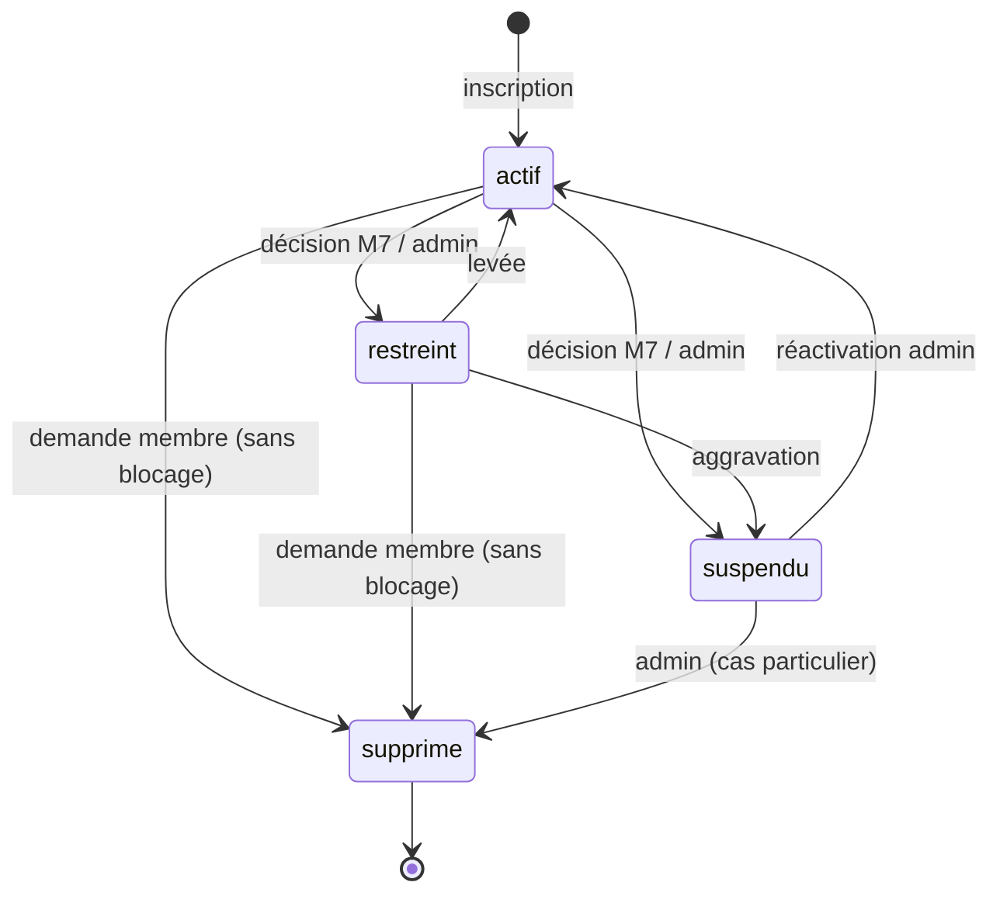
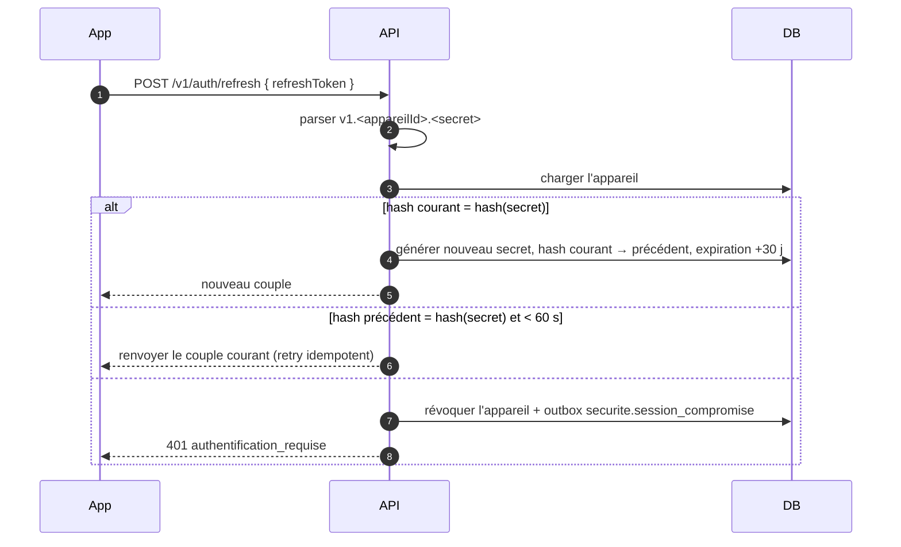

# M1 — Comptes et identité — Plan de conception

> Statut : proposition à valider avant codage — v0.1 — 22/10/2026
> Référence : `Document-architecture-SecondeVie.md`, §5.2.1, §6, §8.
> Dépend du socle commun : `00-socle-commun.md`.

---

## 1. Résumé exécutif

M1 est la **source de vérité de l'identité**. Il possède le compte, les coordonnées
vérifiées, le profil public, les adresses, les appareils/sessions et les preuves de
vérification. Il expose l'authentification à l'API et publie les événements de cycle de vie
du compte. Il ne possède ni les sanctions (M7), ni les commandes (M5), ni les notifications
(M8) : il les consomme ou les appelle via des ports.

Le plan retient quatre choix structurants :

1. **Inscription en deux temps** : création du compte → vérification e-mail → émission des
   jetons et de l'appareil. Un compte non vérifié peut se connecter mais ne peut ni publier
   ni acheter (règle appliquée par un guard, pas par le statut).
2. **Refresh token opaque rotatif** stocké haché par appareil, avec détection de réutilisation
   et révocation immédiate en cas de suspension.
3. **Suppression immédiate et anonymisante**, refusée si une commande, un litige ou un solde
   l'interdit ; les données comptables et les avis sont conservés pseudonymisés par leurs
   modules propriétaires.
4. **Réputation et compteurs reçus par événements** (M5/M7), jamais écrits en direct dans les
   tables d'un autre module.

---

## 2. Périmètre

### 2.1 Inclus dans M1 (v1)

- Inscription e-mail/mot de passe, connexion, déconnexion, refresh.
- Vérification e-mail et téléphone par code à 6 chiffres.
- Réinitialisation du mot de passe par lien à usage unique.
- Profil privé (`/moi`) et profil public (`/utilisateurs/{pseudo}`).
- Adresses de livraison/facturation, adresse par défaut, suppression logique.
- Appareils, sessions, jetons push, révocation.
- Avatar (téléversement signé + variantes).
- Suppression/anonymisation du compte et export RGPD.
- Lecture des sanctions actives (M7) et de la réputation (note, compteurs).
- Jetons d'accès, guards d'authentification, rate limiting des routes sensibles.

### 2.2 Différé (v1.1 ou plus)

- Connexion Apple/Google (schéma compatible, implémentation non planifiée ici).
- Vérification d'identité renforcée (KYC prestataire) : le type `identite` reste modélisé,
  mais le parcours est branché plus tard.
- MFA (TOTP/SMS), gestion des sessions par liste temps réel, biométrie (relève du mobile).
- Changement d'e-mail avec double confirmation : à cadrer (voir points ouverts).

### 2.3 Ce que M1 ne fait pas

- Il ne décide pas des sanctions ; il lit `SanctionPort` et réagit aux événements de M7.
- Il ne calcule ni les ventes/achats ni la note moyenne ; il applique les mises à jour reçues.
- Il n'envoie aucun e-mail/SMS lui-même ; il passe par `NotificationPort` (M8).
- Il ne stocke aucune donnée de carte ; le KYC lourd reste chez Stripe.
- Il ne gère pas les annonces d'un compte supprimé : M2 réagit à `compte.supprime`.

---

## 3. Décisions de conception

| Réf. | Décision | Justification / alternative |
|---|---|---|
| M1-D1 | E-mail = identifiant de connexion ; téléphone optionnel à l'inscription, **obligatoire avant la première transaction et le premier virement** | Réduit la friction d'inscription ; le téléphone reste requis par le transporteur et le KYC Stripe |
| M1-D2 | Aucun jeton émis avant la vérification e-mail | Conforme au flux §5.2.1 ; évite les comptes fantômes ; la connexion reste possible pour renvoyer un code |
| M1-D3 | Access JWT HS256 15 min, `kid` pour rotation ; refresh opaque 30 jours rotatif | Simplicité monolithe ; `kid` prépare la rotation sans casser les jetons en circulation |
| M1-D4 | Refresh = `v1.<appareilId>.<secret>` ; hash HMAC-SHA256 avec poivre ; grâce de 60 s sur l'ancien jeton | Permet la détection de vol sans casser les retries réseau |
| M1-D5 | Claim `ver` (version de sécurité) dans l'access token ; incrémenté à la suspension et au changement de mot de passe | Révocation quasi immédiate sans requête DB à chaque appel ; vérification renforcée sur les routes sensibles |
| M1-D6 | Code de vérification haché en HMAC-SHA256 (pas Argon2) | 6 chiffres = faible entropie ; le poivre et la limitation à 5 essais suffisent, Argon2 serait coûteux pour rien |
| M1-D7 | Suppression **immédiate** avec anonymisation transactionnelle | Simple et conforme ; alternative : délai de grâce de 30 jours avec annulation |
| M1-D8 | Un seul appareil par `deviceId` client ; 10 sessions actives maximum, les plus anciennes révoquées | Évite l'accumulation ; limite non spécifiée dans le document, à valider |
| M1-D9 | Réputation et compteurs appliqués depuis des événements avec numéro de version | Empêche un événement ancien d'écraser une valeur récente |
| M1-D10 | Connexion sociale différée ; `mot_de_passe_hash` nullable et table `comptes_oauth` réservée | Évite de bloquer le schéma, sans complexité v1 |
| M1-D11 | Avatar via URL signée + worker de variantes (256/512), originaux privés | Réutilise le pipeline média du socle ; pas d'upload binaire dans l'API |
| M1-D12 | `restreint` = lecture + gestion du compte, mais pas de publication, d'achat ni de nouvelle conversation | À valider ; le document ne détaille pas les capacités de ce statut |

---

## 4. Modèle de domaine

### 4.1 Agrégats

| Agrégat | Racine | Contenu | Invariants principaux |
|---|---|---|---|
| **Compte** | `Utilisateur` | Profil (1-1), adresses, appareils, vérifications | E-mail unique normalisé, pseudo unique insensible à la casse, âge ≥ 18, statut cohérent |
| **Session** | `Appareil` | Refresh token courant + précédent, push token | Un `deviceId` par utilisateur, hash courant unique, révocation irréversible |
| **Preuve** | `Verification` | Code, tentatives, expiration | 5 tentatives max, 15 min, code à usage unique |
| **Adresse** | `Adresse` | Lignes, destinataire, défaut | Une seule adresse par défaut active par utilisateur |

`Profil` est une entité interne à l'agrégat Compte (créé et supprimé avec lui). `Adresse` et
`Appareil` sont des agrégats séparés référencés par `utilisateurId`, car ils ont leur propre
cycle de vie et leurs propres endpoints.

### 4.2 Objets-valeurs

| Objet-valeur | Règles |
|---|---|
| `Email` | Trim, NFKC, minuscules ; ≤ 254 ; format RFC pragmatique ; stocké normalisé |
| `Telephone` | `libphonenumber-js`, région par défaut FR, stocké E.164 ; unique si présent |
| `Pseudo` | 3–30 caractères, `^[a-zA-Z0-9._-]+$`, sans espace ; normalisé en minuscules ; liste de noms réservés (`admin`, `support`, `secondevie`…) |
| `MotDePasse` | 10–128 caractères ; non présent dans une fuite connue ; ne contient pas l'e-mail ni le pseudo ; jamais journalisé |
| `DateNaissance` | Date valide, âge ≥ 18 ans à la date d'inscription |
| `CodeVerification` | 6 chiffres, durée 15 min, 5 tentatives, renvoi 60 s, 5 renvois/jour |
| `JetonRafraichissement` | 32 octets aléatoires, base64url, préfixé par l'appareil |

### 4.3 Invariants métier

1. Un e-mail normalisé = un compte, y compris après anonymisation (valeur technique unique).
2. Un pseudo normalisé = un compte ; la casse et les espaces de bord sont ignorés.
3. Le mot de passe n'est jamais renvoyé ni journalisé ; le hash n'est jamais sérialisé.
4. Un compte `supprime` est terminal et ne peut plus s'authentifier.
5. Une adresse référencée par une commande n'est jamais supprimée physiquement.
6. Une seule adresse `estDefaut = true` et non supprimée par utilisateur.
7. Un code de vérification expiré ou consommé ne peut plus être réutilisé.
8. Un appareil révoqué ne peut plus rafraîchir ; son access token expire au plus en 15 min.
9. `nomComplet`, `dateNaissance` et `telephone` sont requis avant le premier virement
   (contrôle exposé via `ComptesQueryPort.estKycLegerComplet`).

### 4.4 Machine à états du compte



| Transition | Acteur | Préconditions | Effets |
|---|---|---|---|
| `actif → restreint` | M7/admin | sanction active | `ver++`, notification, invalidation cache |
| `restreint → actif` | M7/admin | plus de sanction bloquante | notification |
| `actif/restreint → suspendu` | M7/admin | décision | `ver++`, révocation de **tous** les appareils, notification |
| `suspendu → actif` | admin | décision motivée | notification, pas de restauration des sessions |
| `* → supprime` | membre/admin | aucun blocage (commandes, litiges, solde) | anonymisation, révocation, événement |

Le statut ne remplace pas les sanctions : une sanction peut interdire une capacité sans
changer le statut. La politique finale combine `statut` + sanctions actives lues via
`SanctionPort`.

### 4.5 Politiques

- **PolitiqueVerification** : un compte non vérifié peut se connecter, consulter, gérer son
  profil et ses adresses ; il ne peut pas publier, acheter, ni initier de paiement.
- **PolitiqueSuppression** : refuse si `CommandesPort.aDesCommandesOuvertes`,
  `LitigesPort.aLitigeOuvert` ou `PortefeuillePort.soldeNonNul` ; en cas d'indisponibilité
  d'un port, **fail closed** (503) plutôt que de supprimer à l'aveugle.
- **PolitiqueMotDePasse** : longueur, fuite connue, similarité avec e-mail/pseudo.
- **PolitiqueSession** : 10 appareils actifs max, purge après 90 jours d'inactivité.

---

## 5. Modèle de données

### 5.1 Schéma Prisma (extrait normatif)

```prisma
enum StatutCompte {
  actif
  restreint
  suspendu
  supprime
}

enum RoleCompte {
  membre
  moderateur
  admin
}

enum TypeVerification {
  email
  telephone
  identite
}

enum StatutVerification {
  en_attente
  valide
  refuse
  expire
}

enum Plateforme {
  ios
  android
  web
}

enum VisibiliteProfil {
  public
  membres
}

model Utilisateur {
  id                  String       @id @default(uuid()) @db.Uuid
  email               String       @unique @db.VarChar(254)
  telephone           String?      @unique @db.VarChar(20)
  motDePasseHash      String?      @map("mot_de_passe_hash")
  pseudo              String       @db.VarChar(30)
  pseudoNormalise     String       @unique @map("pseudo_normalise") @db.VarChar(30)
  nomComplet          String?      @map("nom_complet") @db.VarChar(120)
  dateNaissance       DateTime?    @map("date_naissance") @db.Date
  pays                String       @default("FR") @db.Char(2)
  statut              StatutCompte @default(actif)
  role                RoleCompte   @default(membre)
  emailVerifieLe      DateTime?    @map("email_verifie_le") @db.Timestamptz(3)
  telephoneVerifieLe  DateTime?    @map("telephone_verifie_le") @db.Timestamptz(3)
  noteMoyenne         Decimal      @default(0) @map("note_moyenne") @db.Decimal(2, 1)
  nbVentes            Int          @default(0) @map("nb_ventes")
  nbAchats            Int          @default(0) @map("nb_achats")
  reputationVersion   Int          @default(0) @map("reputation_version")
  versionSecurite     Int          @default(0) @map("version_securite")
  derniereConnexionLe DateTime?    @map("derniere_connexion_le") @db.Timestamptz(3)
  supprimeLe          DateTime?    @map("supprime_le") @db.Timestamptz(3)
  version             Int          @default(0)
  creeLe              DateTime     @default(now()) @map("cree_le") @db.Timestamptz(3)
  majLe               DateTime     @updatedAt @map("maj_le") @db.Timestamptz(3)

  profil           Profil?
  adresses         Adresse[]
  appareils        Appareil[]
  verifications    Verification[]
  reinitialisations ReinitialisationMotDePasse[]

  @@index([statut])
  @@index([creeLe])
  @@map("utilisateurs")
}

model Profil {
  id             String           @id @default(uuid()) @db.Uuid
  utilisateurId  String           @unique @map("utilisateur_id") @db.Uuid
  avatarUrl      String?          @map("avatar_url")
  bio            String?          @db.VarChar(300)
  tailleCm       Int?             @map("taille_cm")
  pointure       Int?
  stylesPreferes String[]         @map("styles_preferes")
  visibilite     VisibiliteProfil @default(public)
  langue         String           @default("fr") @db.Char(2)
  creeLe         DateTime         @default(now()) @map("cree_le") @db.Timestamptz(3)
  majLe          DateTime         @updatedAt @map("maj_le") @db.Timestamptz(3)

  utilisateur Utilisateur @relation(fields: [utilisateurId], references: [id], onDelete: Cascade)

  @@map("profils")
}

model Adresse {
  id            String    @id @default(uuid()) @db.Uuid
  utilisateurId String    @map("utilisateur_id") @db.Uuid
  libelle       String    @db.VarChar(40)
  destinataire  String    @db.VarChar(120)
  ligne1        String    @db.VarChar(120)
  ligne2        String?   @db.VarChar(120)
  codePostal    String    @map("code_postal") @db.VarChar(10)
  ville         String    @db.VarChar(120)
  pays          String    @default("FR") @db.Char(2)
  telephone     String    @db.VarChar(20)
  estDefaut     Boolean   @default(false) @map("est_defaut")
  supprimeeLe   DateTime? @map("supprimee_le") @db.Timestamptz(3)
  creeLe        DateTime  @default(now()) @map("cree_le") @db.Timestamptz(3)
  majLe         DateTime  @updatedAt @map("maj_le") @db.Timestamptz(3)

  utilisateur Utilisateur @relation(fields: [utilisateurId], references: [id])

  @@index([utilisateurId])
  @@map("adresses")
}

model Appareil {
  id                        String     @id @default(uuid()) @db.Uuid
  utilisateurId             String     @map("utilisateur_id") @db.Uuid
  plateforme                Plateforme
  deviceId                  String     @map("device_id") @db.VarChar(128)
  refreshTokenHash          String?    @unique @map("refresh_token_hash") @db.VarChar(128)
  refreshTokenPrecedentHash String?    @map("refresh_token_precedent_hash") @db.VarChar(128)
  refreshTokenExpireLe      DateTime?  @map("refresh_token_expire_le") @db.Timestamptz(3)
  pushToken                 String?    @map("push_token") @db.VarChar(512)
  derniereActiviteLe        DateTime?  @map("derniere_activite_le") @db.Timestamptz(3)
  revoqueLe                 DateTime?  @map("revoque_le") @db.Timestamptz(3)
  creeLe                    DateTime   @default(now()) @map("cree_le") @db.Timestamptz(3)

  utilisateur Utilisateur @relation(fields: [utilisateurId], references: [id])

  @@unique([utilisateurId, deviceId])
  @@index([utilisateurId, revoqueLe])
  @@map("appareils")
}

model Verification {
  id             String             @id @default(uuid()) @db.Uuid
  utilisateurId  String             @map("utilisateur_id") @db.Uuid
  type           TypeVerification
  statut         StatutVerification @default(en_attente)
  fournisseurRef String?            @map("fournisseur_ref") @db.VarChar(120)
  codeHash       String?            @map("code_hash") @db.VarChar(128)
  tentatives     Int                @default(0)
  expireLe       DateTime           @map("expire_le") @db.Timestamptz(3)
  valideLe       DateTime?          @map("valide_le") @db.Timestamptz(3)
  creeLe         DateTime           @default(now()) @map("cree_le") @db.Timestamptz(3)

  utilisateur Utilisateur @relation(fields: [utilisateurId], references: [id], onDelete: Cascade)

  @@index([utilisateurId, type, statut])
  @@index([expireLe])
  @@map("verifications")
}

model ReinitialisationMotDePasse {
  id            String    @id @default(uuid()) @db.Uuid
  utilisateurId String    @map("utilisateur_id") @db.Uuid
  jetonHash     String    @unique @map("jeton_hash") @db.VarChar(128)
  expireLe      DateTime  @map("expire_le") @db.Timestamptz(3)
  utiliseLe     DateTime? @map("utilise_le") @db.Timestamptz(3)
  creeLe        DateTime  @default(now()) @map("cree_le") @db.Timestamptz(3)

  utilisateur Utilisateur @relation(fields: [utilisateurId], references: [id], onDelete: Cascade)

  @@index([utilisateurId])
  @@map("reinitialisations_mot_de_passe")
}
```

`CompteOAuth` (fournisseur, sujet, utilisateurId, e-mail vérifié) est réservé pour v1.1.

### 5.2 Contraintes SQL ajoutées manuellement

```sql
-- Une seule adresse par défaut active par utilisateur
CREATE UNIQUE INDEX adresses_defaut_unique
  ON adresses (utilisateur_id)
  WHERE est_defaut = true AND supprimee_le IS NULL;

-- Un seul code actif par (utilisateur, type)
CREATE UNIQUE INDEX verifications_actives_unique
  ON verifications (utilisateur_id, type)
  WHERE statut = 'en_attente';

-- Cohérence de l'anonymisation
ALTER TABLE utilisateurs
  ADD CONSTRAINT utilisateur_supprime_coherent
  CHECK (statut <> 'supprime' OR supprime_le IS NOT NULL);
```

### 5.3 Index et performances

- `utilisateurs(email)` et `utilisateurs(pseudo_normalise)` : uniques, servent la connexion
  et la recherche de profil public.
- `appareils(utilisateur_id, revoque_le)` : liste des sessions.
- `verifications(expire_le)` : purge planifiée.
- `profil` et `adresses` sont chargés en une requête avec `include` contrôlé (pas de N+1).
- Le profil public ne lit que `Utilisateur` + `Profil` + compteurs ; les annonces viennent
  de M3/M2, jamais d'une jointure inter-module.

### 5.4 Rétention

| Donnée | Durée | Mécanisme |
|---|---|---|
| Compte actif | tant que le compte existe | — |
| Compte supprimé | anonymisé immédiatement ; identifiant conservé pour l'intégrité référentielle | job de purge des traces |
| Codes de vérification | expiration + 30 jours | purge quotidienne |
| Jetons de réinitialisation | expiration + 7 jours | purge quotidienne |
| Appareils inactifs | 90 jours | purge quotidienne |
| Exports RGPD | 7 jours | suppression S3 planifiée |
| Logs d'audit | 12 mois | M9 |

---

## 6. Cas d'usage et API

### 6.1 Table des endpoints

`(+)` = route ajoutée au contrat d'architecture, à valider.

| Méthode | Route | Cas d'usage | Accès | Notes |
|---|---|---|---|---|
| POST | `/v1/auth/inscription` | `InscrireCompte` | Public, 5/h/IP | Crée compte + profil + code e-mail |
| POST | `/v1/auth/email/verifier` (+) | `VerifierEmail` | Public, 10/10 min/IP | Code 6 chiffres, renvoie les jetons + appareil |
| POST | `/v1/auth/email/renvoyer` (+) | `RenvoyerCodeEmail` | Public, 3/15 min/IP | Réponse générique |
| POST | `/v1/auth/telephone/verifier` (+) | `VerifierTelephone` | Auth | Code SMS |
| POST | `/v1/auth/telephone/renvoyer` (+) | `RenvoyerCodeTelephone` | Auth, 3/15 min | — |
| POST | `/v1/auth/connexion` | `Connecter` | Public, 10/min/IP | Verrou progressif après 5 échecs |
| POST | `/v1/auth/refresh` | `RafraichirSession` | Public (refresh) | Rotation |
| POST | `/v1/auth/deconnexion` | `Deconnecter` | Auth | Révoque l'appareil courant |
| POST | `/v1/auth/mot-de-passe/reinitialiser` | `DemanderReinitialisation` | Public, 3/h/IP | Toujours `202` |
| POST | `/v1/auth/mot-de-passe/reinitialiser/confirmer` (+) | `ConfirmerReinitialisation` | Public | Jeton à usage unique |
| GET | `/v1/moi` | `ConsulterMoi` | Auth | Profil privé + sanctions + préférences |
| PATCH | `/v1/moi` | `MettreAJourProfil` | Auth | `version` optimiste |
| GET | `/v1/moi/adresses` | `ListerAdresses` | Auth | Actives uniquement |
| POST | `/v1/moi/adresses` | `AjouterAdresse` | Auth | — |
| PATCH | `/v1/moi/adresses/{id}` (+) | `ModifierAdresse` | Auth + propriétaire | — |
| DELETE | `/v1/moi/adresses/{id}` | `SupprimerAdresse` | Auth + propriétaire | Logique si commande |
| POST | `/v1/moi/adresses/{id}/defaut` (+) | `DefinirAdresseDefaut` | Auth + propriétaire | Idempotent |
| POST | `/v1/moi/avatar` (+) | `PreparerAvatar` | Auth | URL S3 signée |
| POST | `/v1/moi/avatar/confirmer` (+) | `ConfirmerAvatar` | Auth | Déclenche les variantes |
| GET | `/v1/moi/appareils` (+) | `ListerAppareils` | Auth | Sans jetons |
| DELETE | `/v1/moi/appareils/{id}` (+) | `RevoquerAppareil` | Auth + propriétaire | Idempotent |
| PUT | `/v1/moi/appareils/push-token` (+) | `MettreAJourPushToken` | Auth | Upsert par `deviceId` |
| GET | `/v1/utilisateurs/{pseudo}` | `ConsulterProfilPublic` | Public | 404 si `supprime` |
| DELETE | `/v1/moi` | `DemanderSuppression` | Auth + mot de passe | Blocages vérifiés |
| POST | `/v1/moi/export` (+) | `DemanderExport` | Auth | `202` + job |
| GET | `/v1/moi/export/{id}` (+) | `ConsulterExport` | Auth + propriétaire | URL signée 15 min |

### 6.2 Payloads clés

**Inscription**

```http
POST /v1/auth/inscription
Content-Type: application/json

{
  "email": "alice@example.com",
  "pseudo": "alice_vintage",
  "motDePasse": "…",
  "dateNaissance": "1997-04-12",
  "pays": "FR"
}
```

Réponse `201` :

```json
{
  "utilisateurId": "…",
  "email": "alice@example.com",
  "emailVerifie": false,
  "verificationEnvoyeeLe": "2026-10-22T10:00:00Z",
  "expireLe": "2026-10-22T10:15:00Z"
}
```

**Vérification e-mail**

```http
POST /v1/auth/email/verifier
Content-Type: application/json

{
  "email": "alice@example.com",
  "code": "428193",
  "appareil": {
    "deviceId": "dev_ios_9f2c…",
    "plateforme": "ios",
    "pushToken": "…"
  }
}
```

Réponse `200` : `{ accessToken, refreshToken, expireDans: 900, utilisateur: {…} }`.

**Connexion**

```http
POST /v1/auth/connexion
{ "email": "alice@example.com", "motDePasse": "…", "appareil": { "deviceId": "…", "plateforme": "ios" } }
```

Réponse `200` identique à la vérification ; `403 autorisation_refusee` avec
`details.raison = "compte_suspendu"` si applicable.

**Refresh**

```http
POST /v1/auth/refresh
{ "refreshToken": "v1.<appareilId>.<secret>" }
```

Réponse `200` : nouveau couple ; l'ancien refresh est invalidé (sauf retry dans la grâce de
60 s).

**Profil**

```http
PATCH /v1/moi
{
  "version": 3,
  "pseudo": "alice.seconde.vie",
  "nomComplet": "Alice Martin",
  "telephone": "+33612345678",
  "dateNaissance": "1997-04-12",
  "profil": { "bio": "…", "tailleCm": 168, "pointure": 39, "stylesPreferes": ["vintage"] }
}
```

Les champs `email`, `motDePasse`, `statut`, `role` et les compteurs sont **non modifiables**
par cette route. Un 409 `etat_incompatible` renvoie `details.versionActuelle`.

### 6.3 Flux — inscription et première connexion

```mermaid
sequenceDiagram
  autonumber
  actor U as Membre
  participant App
  participant API
  participant DB as PostgreSQL
  participant OB as Outbox
  participant M8 as M8 Notifications

  U->>App: formulaire d'inscription
  App->>API: POST /v1/auth/inscription
  API->>API: valider, normaliser, vérifier unicité
  API->>DB: BEGIN ; INSERT utilisateur + profil + verification + outbox ; COMMIT
  OB->>M8: notification.envoyer (code 6 chiffres)
  M8-->>U: e-mail
  U->>App: saisit le code
  App->>API: POST /v1/auth/email/verifier
  API->>DB: vérifier hash, expiration, tentatives
  API->>DB: BEGIN ; email_verifie_le, INSERT appareil, outbox compte.email_verifie ; COMMIT
  API-->>App: access + refresh
```

### 6.4 Flux — rotation et détection de réutilisation



---

## 7. Sécurité

### 7.1 Mots de passe

- **Argon2id** : mémoire 64 Mo, 3 itérations, parallélisme 1 ; paramètres versionnés
  (`argon2id$v=19$m=65536,t=3,p=1$…`) pour permettre une migration.
- Longueur 10–128 ; vérification de fuite via `VerificateurFuitePort` (HIBP k-anonymity) ;
  en cas d'indisponibilité du service, **fail-open** avec métrique et alerte (ne pas bloquer
  une inscription pour une panne externe).
- Interdiction de contenir l'e-mail local, le pseudo ou une variante triviale.
- Vérification factice avec un hash constant quand l'e-mail est inconnu, pour un temps de
  réponse stable.

### 7.2 Jetons

- **Access** : HS256, `iss=secondevie`, `aud∈{mobile,admin}`, `sub`, `role`, `sid`
  (appareil), `ver` (version de sécurité), `emailVerifie`, `iat`, `exp` (15 min),
  tolérance d'horloge 30 s.
- **Refresh** : opaque, 32 octets, HMAC-SHA256 avec poivre serveur, stocké uniquement haché ;
  expiration 30 jours glissante, plafond absolu 90 jours.
- **Rotation** : nouveau secret à chaque usage ; l'ancien hash est conservé 60 s pour les
  retries ; au-delà, réutilisation = compromission → révocation de l'appareil + notification.
- **Suspension** : `versionSecurite++` + révocation de tous les appareils ; les access tokens
  en circulation sont refusés par `CompteActifGuard` (cache Redis 60 s, contrôle DB sur les
  routes sensibles).
- **Déconnexion** : révoque l'appareil courant uniquement.

### 7.3 Vérifications

- Code 6 chiffres généré avec `crypto.randomInt` ; HMAC-SHA256 avec poivre serveur et
  contexte (`utilisateurId:type:code`) ; comparaison à temps constant.
- Expiration 15 min, 5 tentatives, blocage 1 h, renvoi 60 s, 5 renvois/jour.
- Un nouveau code invalide l'ancien (index partiel).
- Réponses génériques sur le renvoi (ne pas révéler l'existence d'un compte).
- Le téléphone est normalisé E.164 avant envoi ; rejet des numéros virtuels connus si le
  fournisseur le permet (à brancher en M8).

### 7.4 Anti-abus

| Route | Limite |
|---|---|
| `POST /auth/inscription` | 5/h/IP |
| `POST /auth/connexion` | 10/min/IP + 5 échecs/compte → 15 min |
| `POST /auth/email/renvoyer` | 3/15 min/IP + 5/jour/compte |
| `POST /auth/email/verifier` | 10/10 min/IP |
| `POST /auth/mot-de-passe/reinitialiser` | 3/h/IP |
| Routes authentifiées | 100/min/IP + 100/min/utilisateur |

- Verrouillage progressif : 5 échecs → 15 min ; 10 échecs → 1 h ; notification e-mail.
- Réponses et délais constants pour éviter l'énumération ; l'inscription révèle
  nécessairement l'unicité de l'e-mail, mais avec un message neutre et un rate limit strict.

### 7.5 Vie privée et RGPD

- **Export** : job asynchrone, archive JSON (profil, adresses, appareils, consentements,
  données des autres modules via ports) + fichiers ; URL signée 15 min, conservation 7 jours,
  journal d'audit.
- **Suppression** : confirmation par mot de passe ; blocages ; anonymisation :
  - `email = supprime+<uuid>@invalid.secondevie`, `telephone = NULL`, `nomComplet = NULL`,
    `dateNaissance = NULL`, `motDePasseHash = NULL`, `pseudo = membre-<8 chars>`,
    `pseudoNormalise = idem`, `statut = supprime`, `supprimeLe = now()` ;
  - profil vidé (avatar supprimé, bio/tailles/styles effacés) ;
  - adresses supprimées logiquement, appareils révoqués ;
  - codes et jetons purgés ;
  - événement `compte.supprime` pour M2 (archivage), M4 (fermeture), M8 (purge push).
- Les avis et données comptables restent chez M7/M5, pseudonymisés par l'identifiant.
- Aucun e-mail/téléphone/token dans les logs ; `redact` pino.

---

## 8. Événements

### 8.1 Émis

| Événement | Payload (sans PII) | Consommateurs |
|---|---|---|
| `compte.cree` | `utilisateurId`, `pseudo`, `creeLe` | M5 (portefeuille), M8 (bienvenue), M9 (audit) |
| `compte.email_verifie` | `utilisateurId`, `valideLe` | M8, M9 |
| `compte.telephone_verifie` | `utilisateurId`, `valideLe` | M5 (KYC), M8 |
| `compte.statut_modifie` | `utilisateurId`, `ancienStatut`, `nouveauStatut`, `motif`, `versionSecurite` | M2, M3, M4, M5, M8 |
| `compte.mot_de_passe_modifie` | `utilisateurId`, `modifieLe`, `sessionsRevoquees` | M8 (sécurité) |
| `compte.supprime` | `utilisateurId`, `supprimeLe` | M2, M4, M5, M7, M8, M9 |
| `appareil.revoque` | `utilisateurId`, `appareilId`, `raison` | M8 |
| `securite.session_compromise` | `utilisateurId`, `appareilId`, `detecteLe` | M8, M9 |
| `reputation.mise_a_jour` | `utilisateurId`, `noteMoyenne`, `nbVentes`, `nbAchats`, `version` | M3 (tri), M9 |

### 8.2 Consommés

| Événement | Source | Traitement |
|---|---|---|
| `reputation.recalculer` | M7 | applique note/counters si `version` > `reputationVersion` |
| `commande.cloturee` | M5 | incrémente `nbVentes`/`nbAchats` de façon idempotente |
| `sanction.appliquee` / `sanction.levee` | M7 | invalide le cache de sanctions, applique `restreint`/`suspendu` si la sanction le prévoit |
| `avis.publie` | M7 | déclenche éventuellement un recalcul de réputation (délégué à M7) |

> La note moyenne est **calculée par M7** (source des avis) et poussée à M1. M1 ne lit jamais
> la table `avis`.

---

## 9. Ports et intégrations

| Port | Sens | Rôle | Adaptateur v1 |
|---|---|---|---|
| `UtilisateurRepository` | sortie | persistance | Prisma |
| `ProfilRepository` | sortie | persistance | Prisma |
| `AdresseRepository` | sortie | persistance | Prisma |
| `AppareilRepository` | sortie | persistance | Prisma |
| `VerificationRepository` | sortie | persistance | Prisma |
| `ReinitialisationRepository` | sortie | persistance | Prisma |
| `HacheurMotDePassePort` | sortie | Argon2id | `argon2` |
| `EmetteurJetonAccesPort` | sortie | signer/vérifier JWT | `jose` |
| `GenerateurSecretPort` | sortie | secrets/codes | `crypto` |
| `HacheurCodePort` | sortie | HMAC des codes | `crypto` |
| `VerificateurFuitePort` | sortie | HIBP | HTTP k-anonymity |
| `NotificationPort` | sortie | e-mails/SMS/push | M8 via outbox |
| `AuditPort` | sortie | journal d'audit | M9 |
| `SanctionPort` | entrée | sanctions actives | M7 (lecture, cache 60 s) |
| `CommandesPort` | entrée | commandes ouvertes | M5 |
| `LitigesPort` | entrée | litige ouvert | M7 |
| `PortefeuillePort` | entrée | solde non nul | M5 |
| `StockageMediaPort` | sortie | avatar | S3 + worker |
| `CachePort` | sortie | statut/version, sanctions | Redis |
| `HorlogePort` | sortie | temps testable | système |
| `OutboxPort` | sortie | événements | PostgreSQL |

Règle : les ports `SanctionPort`, `CommandesPort`, `LitigesPort`, `PortefeuillePort` sont
implémentés par des **clients internes** qui appellent le service exposé du module
propriétaire ; aucun accès SQL direct.

---

## 10. Arborescence prévue

```
apps/api/src/modules/comptes/
├── domain/
│   ├── entites/{utilisateur,profil,adresse,appareil,verification}.ts
│   ├── valeurs/{email,telephone,pseudo,mot-de-passe,code-verification,jeton-refresh}.ts
│   ├── politiques/{politique-verification,politique-suppression,politique-session}.ts
│   ├── evenements/{compte-cree,compte-supprime,compte-statut-modifie}.ts
│   ├── erreurs/{email-deja-utilise,pseudo-deja-utilise,code-invalide,compte-bloque}.ts
│   └── ports/*.ts
├── application/
│   ├── cas-usage/
│   │   ├── inscrire-compte.ts
│   │   ├── verifier-email.ts
│   │   ├── renvoyer-code-email.ts
│   │   ├── connecter.ts
│   │   ├── rafraichir-session.ts
│   │   ├── deconnecter.ts
│   │   ├── demander-reinitialisation.ts
│   │   ├── confirmer-reinitialisation.ts
│   │   ├── consulter-moi.ts
│   │   ├── mettre-a-jour-profil.ts
│   │   ├── gerer-adresses.ts
│   │   ├── gerer-appareils.ts
│   │   ├── demander-suppression.ts
│   │   ├── demander-export.ts
│   │   └── appliquer-reputation.ts
│   └── dto/*.ts
├── infrastructure/
│   ├── persistance/{prisma-utilisateur.repository.ts,…}
│   ├── securite/{argon2-hacheur.ts,jwt-emetteur.ts,hmac-code.ts}
│   └── adaptateurs/{notification.outbox.ts,sanction.client.ts,…}
├── presentation/http/
│   ├── controleurs/{auth,moi,adresses,appareils,utilisateurs-publics}.controleur.ts
│   └── schemas/*.ts
└── comptes.module.ts
```

---

## 11. Tests

### 11.1 Unitaires (domaine)

- `Email` : normalisation (espaces, casse, Unicode), longueur, invalides.
- `Pseudo` : regex, longueur, casse, noms réservés.
- `MotDePasse` : longueur, fuite, similarité.
- `DateNaissance` : 17 ans refusé, 18 ans accepté, date future refusée.
- `CodeVerification` : expiration, 5 tentatives, renvoi, invalidation de l'ancien.
- `JetonRefresh` : format, rotation, grâce, détection de réutilisation.
- `PolitiqueSuppression` : chaque blocage, fail-closed.
- Machine à états : table exhaustive des transitions autorisées/interdites.
- `Adresse` : une seule par défaut, suppression logique.

### 11.2 Intégration (Testcontainers + Supertest)

1. Inscription → code stocké haché → vérification → jetons + appareil.
2. Code faux 5 fois → blocage 1 h ; code expiré → refus.
3. Connexion e-mail inconnu / mot de passe faux → même code et temps de réponse.
4. Refresh nominal, retry dans la grâce, réutilisation après grâce → révocation.
5. Suspension → refresh refusé, `ver` incrémenté, cache invalidé.
6. Réinitialisation : jeton usage unique, expiration, révocation des sessions.
7. Adresses : défaut concurrent (deux requêtes) → une seule gagnante ; suppression
   référencée par commande → logique.
8. Suppression : chaque blocage, anonymisation, événement outbox dans la même transaction.
9. Export : job, URL signée, expiration.
10. Unicité concurrente e-mail/pseudo (deux inscriptions simultanées).
11. Profil public : 404 si supprimé, visibilité `membres` respectée.

### 11.3 Sécurité et contrat

- IDOR : accès à l'adresse/appareil/export d'un autre membre → 404/403.
- JWT falsifié, expiré, mauvais `aud`, `ver` obsolète.
- Rate limits et en-tête `Retry-After`.
- OpenAPI : routes, codes d'erreur, schémas ; Schemathesis sur les endpoints publics.

---

## 12. Lots d'implémentation

| Lot | Contenu | Critère d'acceptation |
|---|---|---|
| **L1** | Schéma Prisma, migration, modèles de domaine, repositories, seed | Tests de domaine verts ; migration up/down ; contraintes SQL présentes |
| **L2** | Inscription, code e-mail, vérification, outbox → M8 (stub Mailpit) | Parcours complet ; code haché ; événement écrit dans la même transaction |
| **L3** | Connexion, refresh, déconnexion, guards, `ver`, rate limiting | Rotation/reuse testés ; suspension effective ; routes protégées |
| **L4** | `/moi`, profil, adresses, avatar | Validation Zod, optimistic locking, défaut unique |
| **L5** | Appareils, push token, réinitialisation de mot de passe | Liste sans secrets ; révocation idempotente ; reset complet |
| **L6** | Suppression, export, réputation/counters, audit, métriques | Blocages testés ; anonymisation ; événements consommés idempotents |

Chaque lot = une PR courte, migration rétrocompatible, OpenAPI à jour, tests d'intégration.

---

## 13. Observabilité

- **Métriques** : inscriptions réussies/échouées, taux de vérification, échecs de connexion,
  réutilisations de refresh, suppressions bloquées, latence Argon2, lag outbox.
- **Alertes** : pic d'échecs d'authentification, réutilisation de refresh, lag outbox > 60 s,
  taux d'échec d'envoi e-mail > 5 %.
- **Logs** : `traceId`, `utilisateurId` (identifiant, pas e-mail), type d'action ; jamais de
  code, mot de passe, token ou adresse complète.

---

## 14. Risques

| Risque | Impact | Mitigation |
|---|---|---|
| Délivrabilité e-mail (M8) | Inscription bloquée | Mailpit en local, fournisseur avec webhooks de bounce, renvoi, fallback support |
| Vol de refresh token | Usurpation | Rotation + détection de réutilisation + révocation + notification |
| Énumération de comptes | Vie privée | Réponses/délais constants, rate limit, codes génériques |
| Suppression alors qu'un paiement est en cours | Perte financière | Blocages fail-closed via ports M5/M7 |
| Coût SMS | Budget | Téléphone optionnel à l'inscription, vérification avant transaction |
| Complexité KYC Stripe | Retard v1 | Port `KycPort` non implémenté, champs obligatoires avant virement seulement |
| Course sur l'unicité e-mail/pseudo | Doublons | Index uniques + gestion d'erreur 409 |
| Sessions multiples | Support | Liste, révocation, purge 90 j |

---

## 15. Points à valider

1. **Téléphone** : optionnel à l'inscription puis obligatoire avant achat/virement
   (recommandé) ou obligatoire dès l'inscription ?
2. **Statut `restreint`** : quelles capacités exactement ? (proposition : lecture + compte,
   pas de publication/achat/nouvelle conversation)
3. **Suppression** : immédiate (proposition) ou délai de grâce de 30 jours annulable ?
4. **Sessions** : limite de 10 appareils et purge à 90 jours acceptées ?
5. **Changement de pseudo** : libre, limité (1 fois/30 j), ou immuable ?
6. **Changement d'e-mail** : double confirmation ancien + nouveau, ou vérification du nouveau
   seulement ? (non planifié dans ce lot)
7. **Connexion sociale** : v1.1 confirmée ?
8. **Export RGPD** : périmètre inter-modules dès la v1 ou export M1 seul d'abord ?
9. **Auth back-office** : bearer token comme le mobile, ou cookie `HttpOnly` + CSRF ?
10. **Avatar** : modération automatique obligatoire avant affichage public ?
