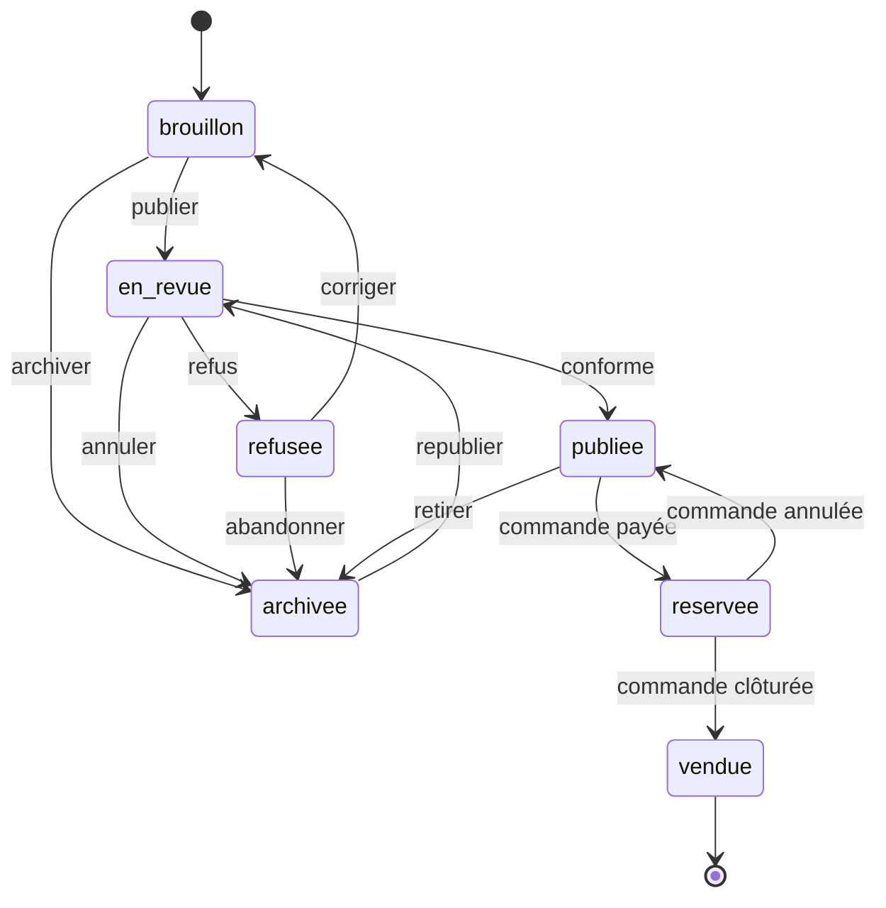
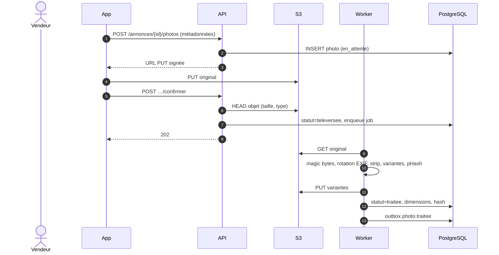

# M2 — Annonces et catalogue — Plan de conception

> Statut : proposition à valider avant codage — v0.1 — 22/10/2026
> Référence : `Document-architecture-SecondeVie.md`, §5.2.2, §6, §8.
> Dépend du socle commun : `00-socle-commun.md`.

---

## 1. Résumé exécutif

M2 porte **l'offre** : l'annonce, ses photos, ses caractéristiques, son prix, ses favoris et
les référentiels (catégories, marques, tailles). Il garantit qu'une annonce est complète,
cohérente avec le catalogue et publiable, mais il ne gère ni la recherche (M3), ni la
transaction (M5), ni la modération humaine (M7).

Choix structurants :

1. **Le statut de l'annonce est la seule vérité** ; toute transition passe par une méthode de
   domaine et une mise à jour conditionnelle en base (pas de mise à jour sauvage).
2. **Publication en trois issues** : conforme → `publiee` ; doute → `en_revue` (revue humaine
   M7) ; violation dure → `refusee` avec motif. Le passage transitoire par `en_revue` est
   interne et ne persiste que s'il y a réellement une revue à faire.
3. **Photos téléversées directement vers S3**, traitées en asynchrone (ré-encodage, EXIF,
   variantes, empreinte perceptuelle). Une annonce ne peut pas être publiée tant que toutes
   ses photos ne sont pas traitées.
4. **Recherche et vues déléguées** : M2 émet des événements vers M3 et consomme les
   interactions ; il ne maintient pas d'index de recherche et ne journalise pas les vues.
5. **Concurrence maîtrisée** : verrou optimiste (`version`), verrou consultatif par vendeur
   pour le quota, mises à jour conditionnelles pour les événements de commande.

---

## 2. Périmètre

### 2.1 Inclus dans M2 (v1)

- Création guidée et brouillon auto-sauvegardé.
- Modification, archivage, republication.
- Photos : URL signée, confirmation, variantes, ordre, photo principale, suppression.
- Référentiels : catégories hiérarchiques (3 niveaux), marques, grilles de tailles.
- Publication avec contrôles automatiques et file de revue humaine.
- Favoris et compteurs (vues, favoris).
- Cycle de vie lié aux commandes : réservation, libération, vente.
- Événements d'indexation pour M3 et notifications pour M8.
- Lecture publique du détail et lecture privée des annonces du membre.

### 2.2 Différé

- Enchères, ventes flash, lots.
- Recommandation personnalisée (M3).
- Gestion complète des référentiels dans le back-office (M9) : v1 = seed + endpoints de
  lecture, administration plus tard.
- Détection globale de doublons à grande échelle (LSH/BK-tree) : v1 = exact global +
  quasi-doublon par vendeur.
- Vidéo, 3D, essayage.

### 2.3 Ce que M2 ne fait pas

- Il ne cherche pas : M3 indexe et interroge.
- Il ne réserve pas une annonce de lui-même : M5 paie, M2 applique.
- Il ne décide pas d'une sanction : M7 décide, M2 applique le refus/archivage.
- Il ne snapshot pas les commandes : M5 fige `annonce_snapshot` au moment de l'achat.
- Il n'envoie pas de notification : M8 consomme les événements.

---

## 3. Décisions de conception

| Réf. | Décision | Justification / alternative |
|---|---|---|
| M2-D1 | M2 possède `Annonce`, `Photo`, `Favori`, `Categorie`, `Marque`, `ReferentielTaille` | Conforme au document ; aucun autre module n'écrit ces tables |
| M2-D2 | Statuts exactement ceux du document ; `archivee` sert de suppression logique | Pas de statut `masquee` inventé ; une suspension passe par `archivee` + journal |
| M2-D3 | `POST /publier` exécute les contrôles dans une transaction et persiste directement l'état final (`publiee`, `en_revue` ou `refusee`) | Évite un état `en_revue` transitoire sans revue réelle |
| M2-D4 | Verrou optimiste par `version` entier | Le mobile hors ligne peut renvoyer sa version ; conflit → 409 |
| M2-D5 | Une annonce n'est publiable que si **toutes** ses photos sont `traitee` | Évite les annonces sans image exploitable |
| M2-D6 | Référence `SV-` + 6 caractères Crockford base32, unique et immuable | Lisible, sans caractères ambigus ; exemple du document respecté |
| M2-D7 | Quota de 20 annonces actives, protégé par un verrou consultatif PostgreSQL par vendeur | Évite la course entre deux publications simultanées |
| M2-D8 | M5 émet `commande.payee/annulee/cloturee` ; **M2 émet ensuite** `annonce.reservee/liberee/vendue` | M2 reste propriétaire de son statut ; alternative : M5 émet directement `annonce.reservee` |
| M2-D9 | Les vues viennent de M3 (`interaction.vue`), appliquées par lots | Une seule source de journalisation ; évite un beacon dupliqué |
| M2-D10 | Compteur de favoris mis à jour dans la même transaction que le favori | Pas de dérive en régime normal ; réconciliation nightly en secours |
| M2-D11 | Référentiels en cache Redis avec version + ETag ; seed v1 | Lectures très chaudes ; M9 invalidera plus tard |
| M2-D12 | Originaux privés, variantes publiques via CDN | Cache CDN efficace sans URL signée expirante sur les images publiques |
| M2-D13 | Doublons : exact global + quasi-doublon (Hamming ≤ 6) par vendeur | Coût maîtrisé ; détection globale approchée en v1.1 |
| M2-D14 | Brouillons purgés après 90 jours ; annonces archivées conservées 2 ans | Limite le stockage ; les commandes gardent leur snapshot chez M5 |
| M2-D15 | Une annonce `reservee` renvoie 404 au public ; l'acheteur la voit via le détail de sa commande (M5) | Évite de stocker l'acheteur dans M2 ; le snapshot M5 suffit |
| M2-D16 | Republication d'une annonce `archivee` : même identifiant et même référence | Conserve l'historique et les liens ; une annonce `vendue` ne se republie pas |
| M2-D17 | Les champs sensibles d'une annonce `publiee` (photos, titre, description) repassent par les contrôles ; le prix et la matière non | Évite de réindexer du contenu non conforme sans revue |
| M2-D18 | Poids obligatoire à la publication, optionnel en brouillon | M6 a besoin du poids pour l'étiquette |
| M2-D19 | La suspension d'un vendeur **masque** ses annonces sans les archiver | Réversible à la levée de sanction ; M3 filtre déjà les vendeurs suspendus |

---

## 4. Modèle de domaine

### 4.1 Agrégats

| Agrégat | Racine | Contenu | Invariants |
|---|---|---|---|
| **Annonce** | `Annonce` | Photos ordonnées (0..n-1) | Propriétaire unique, état de vie, prix, complétude, quota |
| **Favori** | `Favori` | — | Unicité `(utilisateur, annonce)`, idempotence |
| **Catalogue** | `Categorie` | Arbre ≤ 3 niveaux | Slug unique, niveau cohérent, pas de cycle |
| **Marque** | `Marque` | — | Nom normalisé unique |
| **Grille de tailles** | `ReferentielTaille` | — | Libellé unique par catégorie/système |

`Photo` est une entité **interne** à l'agrégat Annonce : on ne la modifie jamais hors du
chargement de son annonce (ordre, suppression, principale). `Favori` est séparé car il
appartient au membre et a ses propres endpoints.

### 4.2 Objets-valeurs

| Objet-valeur | Règles |
|---|---|
| `Reference` | `SV-[0-9A-HJKMNP-TV-Z]{6}`, immuable, unique |
| `Titre` | 5–80 caractères, pas de majuscules abusives (> 50 % de capitales), pas de contact |
| `Description` | 20–2000 caractères, pas de contact (téléphone/e-mail/URL) |
| `Prix` | Entier de centimes, 100–500 000, devise `EUR` |
| `Poids` | Entier 50–30 000 g |
| `Taille` | 1–12 caractères, doit exister dans `ReferentielTaille` si la catégorie l'exige |
| `Couleur` | Liste contrôlée + « autre » |
| `EtatArticle` | Enum du document |
| `OrdrePhoto` | Entier 0..11, unique dans l'annonce, 0 = principale |

### 4.3 Invariants métier

1. Seul le propriétaire modifie une annonce ; un modérateur agit via M7/M9, pas via les
   routes membre.
2. Une annonce `reservee` ou `vendue` est **verrouillée** : ni prix, ni photos, ni texte.
3. Une annonce doit avoir **1 à 12 photos** pour être publiée ; toutes doivent être traitées.
4. La catégorie doit être **active** et **feuille** (aucun enfant actif) à la publication.
5. Si `Categorie.tailleObligatoire`, la taille est obligatoire et doit appartenir à la
   grille de la catégorie.
6. Le prix et le poids respectent les bornes ; `prixOrigine ≥ prix`.
7. Une annonce `refusee` porte toujours un `motifRefus`.
8. Une annonce `publiee` a toujours `publieeLe`.
9. Le quota de 20 annonces actives (`en_revue`, `publiee`, `reservee`) ne peut être dépassé.
10. Une annonce `archivee` peut être republiée ; une annonce `vendue` est terminale.
11. Un favori est unique par couple ; l'ajout/retrait est idempotent.
12. La suppression est logique : aucune annonce ayant un historique de commande n'est
    supprimée physiquement.
13. Une annonce d'un vendeur `suspendu` ou `supprime` n'est jamais visible publiquement,
    même si son statut est `publiee`.

### 4.4 Machine à états



| Transition | Acteur | Préconditions | Effets |
|---|---|---|---|
| `brouillon → en_revue` | vendeur | champs complets, photos traitées, quota, vendeur actif | `version++`, événement de revue ou publication immédiate |
| `en_revue → publiee` | système / M7 | aucun signal bloquant | `publieeLe`, `annonce.publiee`, indexation |
| `en_revue → refusee` | système / M7 | violation | `motifRefus`, `annonce.refusee`, notification |
| `en_revue → archivee` | vendeur | — | retrait de la file de revue |
| `refusee → brouillon` | vendeur | correction | efface `motifRefus` |
| `brouillon/refusee/archivee → archivee` | vendeur | — | suppression logique |
| `publiee → reservee` | système (M5) | `commande.payee` reçue, statut `publiee` | `annonce.reservee`, retrait index |
| `reservee → publiee` | système (M5) | `commande.annulee` | `annonce.liberee`, réindexation |
| `reservee → vendue` | système (M5) | `commande.cloturee` | `annonce.vendue`, retrait index |
| `publiee → archivee` | vendeur | — | `annonce.archivee`, retrait index |
| `archivee → en_revue` | vendeur | contrôle de republiabilité | `publieeLe` réinitialisé après acceptation |

Toute autre transition renvoie `409 etat_incompatible` avec l'état courant.

### 4.5 Politiques

- **PolitiquePublication** : vérifie la complétude, la catégorie, la taille, les photos, les
  mots interdits, les contacts, les doublons et le quota ; renvoie `publiee`, `en_revue` ou
  `refusee`.
- **PolitiqueEdition** : liste les champs modifiables selon l'état ; refuse une édition sur
  `reservee`/`vendue` ; sur `refusee`, toute édition repasse en `brouillon`.
- **PolitiqueVisibilite** : `publiee` = public **si le vendeur est actif** ; `reservee` =
  propriétaire + acheteur via M5 ; les autres = propriétaire, modérateur, admin ; le public
  reçoit 404. Un vendeur `suspendu` ou `supprime` rend ses annonces invisibles sans changer
  leur statut (vérification via `ComptesQueryPort`, cache court).
- **PolitiqueQuota** : compte les annonces `en_revue`, `publiee`, `reservee` ; verrou
  consultatif par vendeur avant comptage et insertion.
- **PolitiqueDoublon** : exact global inter-vendeurs → refus ; quasi-doublon intra-vendeur →
  `a_verifier`.

---

## 5. Modèle de données

### 5.1 Schéma Prisma (extrait normatif)

```prisma
enum StatutAnnonce {
  brouillon
  en_revue
  publiee
  reservee
  vendue
  archivee
  refusee
}

enum EtatArticle {
  neuf_avec_etiquette
  neuf_sans_etiquette
  tres_bon
  bon
  satisfaisant
}

enum StatutTraitementPhoto {
  en_attente
  televersee
  traitee
  rejetee
}

enum StatutModerationPhoto {
  ok
  a_verifier
  refusee
}

enum SystemeTaille {
  EU
  UK
  US
  FR
  universel
}

model Annonce {
  id                String        @id @default(uuid()) @db.Uuid
  reference         String        @unique @db.VarChar(12)
  vendeurId         String        @map("vendeur_id") @db.Uuid
  titre             String?       @db.VarChar(80)
  description       String?       @db.VarChar(2000)
  categorieId       String?       @map("categorie_id") @db.Uuid
  marqueId          String?       @map("marque_id") @db.Uuid
  taille            String?       @db.VarChar(12)
  etat              EtatArticle?
  couleur           String?       @db.VarChar(30)
  matiere           String?       @db.VarChar(60)
  prixCents         Int?          @map("prix_cents")
  prixOrigineCents  Int?          @map("prix_origine_cents")
  devise            String        @default("EUR") @db.Char(3)
  poidsG            Int?          @map("poids_g")
  statut            StatutAnnonce @default(brouillon)
  motifRefus        String?       @map("motif_refus") @db.VarChar(300)
  nbVues            Int           @default(0) @map("nb_vues")
  nbFavoris         Int           @default(0) @map("nb_favoris")
  version           Int           @default(0)
  publieeLe         DateTime?     @map("publiee_le") @db.Timestamptz(3)
  archiveeLe        DateTime?     @map("archivee_le") @db.Timestamptz(3)
  creeLe            DateTime      @default(now()) @map("cree_le") @db.Timestamptz(3)
  majLe             DateTime      @updatedAt @map("maj_le") @db.Timestamptz(3)

  categorie Categorie? @relation(fields: [categorieId], references: [id])
  marque    Marque?    @relation(fields: [marqueId], references: [id])
  photos    Photo[]
  favoris   Favori[]

  @@index([vendeurId, statut, majLe])
  @@index([statut, publieeLe])
  @@index([categorieId, statut])
  @@index([marqueId])
  @@map("annonces")
}

model Photo {
  id              String                @id @default(uuid()) @db.Uuid
  annonceId       String                @map("annonce_id") @db.Uuid
  urlOriginale    String?               @map("url_originale")
  urlVariantes    Json?                 @map("url_variantes")
  ordre           Int
  largeur         Int?
  hauteur         Int?
  perceptHash     String?               @map("percept_hash") @db.VarChar(16)
  statutTraitement StatutTraitementPhoto @default(en_attente) @map("statut_traitement")
  statutModeration StatutModerationPhoto @default(ok) @map("statut_moderation")
  tailleOctets    Int?                  @map("taille_octets")
  mimeType        String?               @map("mime_type") @db.VarChar(40)
  creeLe          DateTime              @default(now()) @map("cree_le") @db.Timestamptz(3)

  annonce Annonce @relation(fields: [annonceId], references: [id], onDelete: Cascade)

  @@index([annonceId, ordre])
  @@index([perceptHash])
  @@map("photos")
}

model Categorie {
  id                String    @id @default(uuid()) @db.Uuid
  parentId          String?   @map("parent_id") @db.Uuid
  nom               String    @db.VarChar(60)
  slug              String    @unique @db.VarChar(60)
  niveau            Int
  tailleObligatoire Boolean   @default(true) @map("taille_obligatoire")
  actif             Boolean   @default(true)
  ordre             Int       @default(0)
  creeLe            DateTime  @default(now()) @map("cree_le") @db.Timestamptz(3)
  majLe             DateTime  @updatedAt @map("maj_le") @db.Timestamptz(3)

  parent  Categorie?  @relation("ArbreCategorie", fields: [parentId], references: [id])
  enfants Categorie[] @relation("ArbreCategorie")
  tailles ReferentielTaille[]
  annonces Annonce[]

  @@index([parentId, ordre])
  @@map("categories")
}

model Marque {
  id           String   @id @default(uuid()) @db.Uuid
  nom          String   @db.VarChar(80)
  nomNormalise String   @unique @map("nom_normalise") @db.VarChar(80)
  slug         String   @unique @db.VarChar(80)
  logoUrl      String?  @map("logo_url")
  verifiee     Boolean  @default(false)
  actif        Boolean  @default(true)
  creeLe       DateTime @default(now()) @map("cree_le") @db.Timestamptz(3)
  majLe        DateTime @updatedAt @map("maj_le") @db.Timestamptz(3)

  annonces Annonce[]

  @@index([actif, nomNormalise])
  @@map("marques")
}

model Favori {
  id            String   @id @default(uuid()) @db.Uuid
  utilisateurId String   @map("utilisateur_id") @db.Uuid
  annonceId     String   @map("annonce_id") @db.Uuid
  creeLe        DateTime @default(now()) @map("cree_le") @db.Timestamptz(3)

  annonce Annonce @relation(fields: [annonceId], references: [id], onDelete: Cascade)

  @@unique([utilisateurId, annonceId])
  @@index([annonceId])
  @@index([utilisateurId, creeLe])
  @@map("favoris")
}

model ReferentielTaille {
  id           String        @id @default(uuid()) @db.Uuid
  categorieId  String        @map("categorie_id") @db.Uuid
  systeme      SystemeTaille
  libelle      String        @db.VarChar(12)
  equivalentCm Int?          @map("equivalent_cm")
  ordre        Int           @default(0)
  creeLe       DateTime      @default(now()) @map("cree_le") @db.Timestamptz(3)

  categorie Categorie @relation(fields: [categorieId], references: [id], onDelete: Cascade)

  @@unique([categorieId, systeme, libelle])
  @@index([categorieId, ordre])
  @@map("referentiels_tailles")
}
```

> `Favori.utilisateurId` ne porte pas de FK Prisma vers `Utilisateur` : la table appartient à
> M2, l'utilisateur à M1. L'intégrité est garantie par le cas d'usage (vérification via
> `ComptesQueryPort`) et un contrôle périodique. Si l'on préfère une FK physique, elle est
> possible sur une base unique mais viole la règle « pas de couplage par les tables » ; à
> trancher (voir points ouverts).

### 5.2 Contraintes SQL ajoutées manuellement

```sql
ALTER TABLE annonces
  ADD CONSTRAINT annonce_prix_bornes CHECK (prix_cents BETWEEN 100 AND 500000),
  ADD CONSTRAINT annonce_prix_origine CHECK (prix_origine_cents IS NULL OR prix_cents IS NULL OR prix_origine_cents >= prix_cents),
  ADD CONSTRAINT annonce_poids_bornes CHECK (poids_g BETWEEN 50 AND 30000),
  ADD CONSTRAINT annonce_refus_motif CHECK (statut <> 'refusee' OR motif_refus IS NOT NULL),
  ADD CONSTRAINT annonce_publiee_date CHECK (statut NOT IN ('publiee','reservee','vendue') OR publiee_le IS NOT NULL),
  ADD CONSTRAINT annonce_complete_si_soumise CHECK (
    statut IN ('brouillon','archivee') OR (
      titre IS NOT NULL AND description IS NOT NULL AND categorie_id IS NOT NULL
      AND etat IS NOT NULL AND couleur IS NOT NULL
      AND prix_cents IS NOT NULL AND poids_g IS NOT NULL
    )
  ),
  ADD CONSTRAINT annonce_compteurs_positifs CHECK (nb_vues >= 0 AND nb_favoris >= 0);

-- Ordre des photos unique, différable pour permettre un réordonnancement en une transaction
ALTER TABLE photos
  ADD CONSTRAINT photos_ordre_unique UNIQUE (annonce_id, ordre) DEFERRABLE INITIALLY DEFERRED;

-- Un seul enfant par nom sous un même parent (les racines sont gérées par un index partiel)
CREATE UNIQUE INDEX categories_nom_racine_unique
  ON categories (nom)
  WHERE parent_id IS NULL;

CREATE UNIQUE INDEX categories_nom_parent_unique
  ON categories (parent_id, nom)
  WHERE parent_id IS NOT NULL;

-- Cohérence du niveau
ALTER TABLE categories
  ADD CONSTRAINT categorie_niveau CHECK (niveau BETWEEN 0 AND 2);
```

### 5.3 Index et performances

- `annonces(vendeur_id, statut, maj_le)` : « mes annonces » paginées.
- `annonces(statut, publiee_le)` : balayages d'administration et réindexation.
- `annonces(categorie_id, statut)`, `annonces(marque_id)` : facettes et contrôles.
- `photos(annonce_id, ordre)` : galerie ; `percept_hash` pour les doublons exacts.
- `favoris(utilisateur_id, cree_le)` : liste ; `favoris(annonce_id)` : comptage.
- `categories(parent_id, ordre)` : arbre ; `marques(actif, nom_normalise)` : autocomplétion.
- Pas d'index plein texte dans M2 : la recherche est chez M3.

### 5.4 Rétention

| Donnée | Durée | Mécanisme |
|---|---|---|
| Brouillon inactif | 90 jours | purge planifiée + objets S3 |
| Annonce publiée | tant que publiée | — |
| Annonce archivée | 2 ans | purge après vérification qu'aucune commande ne la référence |
| Annonce vendue | 10 ans (obligation comptable via M5) | conservation logique, pas de purge M2 avant M5 |
| Photos d'annonce purgée | immédiat | suppression S3 + variantes CDN |
| Objets orphelins (`tmp/`) | 7 jours | cycle de vie S3 |

---

## 6. Cas d'usage et API

### 6.1 Table des endpoints

`(+)` = route ajoutée au contrat d'architecture, à valider.

| Méthode | Route | Cas d'usage | Accès | Notes |
|---|---|---|---|---|
| POST | `/v1/annonces` | `CreerBrouillon` | Auth + e-mail vérifié | `{}` accepté ; renvoie id/référence |
| PATCH | `/v1/annonces/{id}` | `ModifierAnnonce` | Propriétaire | `version` obligatoire |
| GET | `/v1/annonces/{id}` | `ConsulterAnnonce` | Public / propriétaire / modérateur | 404 si masquée |
| GET | `/v1/moi/annonces` | `ListerMesAnnonces` | Auth | Curseur + filtre `statut` |
| POST | `/v1/annonces/{id}/photos` | `PreparerPhoto` | Propriétaire | URL S3 signée |
| POST | `/v1/annonces/{id}/photos/{photoId}/confirmer` (+) | `ConfirmerPhoto` | Propriétaire | Déclenche le worker |
| DELETE | `/v1/annonces/{id}/photos/{photoId}` | `SupprimerPhoto` | Propriétaire | Interdit si `reservee`/`vendue` |
| PATCH | `/v1/annonces/{id}/photos/ordre` (+) | `ReordonnerPhotos` | Propriétaire | Liste complète des ids |
| POST | `/v1/annonces/{id}/photos/{photoId}/principale` (+) | `DefinirPhotoPrincipale` | Propriétaire | Raccourci de réordonnancement |
| POST | `/v1/annonces/{id}/publier` | `PublierAnnonce` | Propriétaire | `version` ; peut renvoyer `en_revue` |
| POST | `/v1/annonces/{id}/archiver` | `ArchiverAnnonce` | Propriétaire | Idempotent |
| POST | `/v1/annonces/{id}/republier` (+) | `RepublierAnnonce` | Propriétaire | Depuis `archivee` uniquement |
| POST | `/v1/annonces/{id}/favori` | `AjouterFavori` | Auth + e-mail vérifié | Idempotent |
| DELETE | `/v1/annonces/{id}/favori` | `RetirerFavori` | Auth | Idempotent |
| GET | `/v1/referentiels/categories` | `ListerCategories` | Public | Cache + ETag |
| GET | `/v1/referentiels/marques?q=` | `RechercherMarques` | Public | Autocomplétion, 20 max |
| GET | `/v1/referentiels/tailles?categorieId=` (+) | `ListerTailles` | Public | Systèmes + libellés |

`GET /v1/moi/favoris` reste exposé par **M3** (§5.2.3) ; M2 fournit le port interne
`FavoriQueryPort.listerFavoris(utilisateurId, curseur)`.

### 6.2 Payloads clés

**Création de brouillon**

```http
POST /v1/annonces
{ "titre": "Jean Levi's 501", "categorieId": "…" }
```

Réponse `201` : `{ id, reference, statut: "brouillon", version: 0, creeLe }`. Tous les
champs sont optionnels à la création ; la complétude est vérifiée à la publication.

**Mise à jour**

```http
PATCH /v1/annonces/{id}
{
  "version": 4,
  "titre": "Jean Levi's 501 W30",
  "description": "Porté quelques fois, très bon état, aucune tache.",
  "categorieId": "…",
  "marqueId": "…",
  "taille": "W30",
  "etat": "tres_bon",
  "couleur": "bleu",
  "matiere": "coton",
  "prixCents": 2800,
  "prixOrigineCents": 9900,
  "poidsG": 450
}
```

- Champs inconnus → `400 validation_echec`.
- `version` différente → `409 etat_incompatible`, `details.versionActuelle`.
- Édition d'une `refusee` → repasse `brouillon` et efface `motifRefus`.

**Préparation d'une photo**

```http
POST /v1/annonces/{id}/photos
{
  "nomFichier": "jean-face.jpg",
  "mimeType": "image/jpeg",
  "tailleOctets": 2450000,
  "largeur": 3024,
  "hauteur": 4032
}
```

Réponse `201` :

```json
{
  "photoId": "…",
  "urlTeleversement": "https://s3…/tmp/…?X-Amz-Signature=…",
  "expireLe": "2026-10-22T10:10:00Z",
  "method": "PUT",
  "headers": { "Content-Type": "image/jpeg" }
}
```

**Confirmation**

```http
POST /v1/annonces/{id}/photos/{photoId}/confirmer
```

Réponse `202` : `{ statutTraitement: "en_attente" }`.

**Publication**

```http
POST /v1/annonces/{id}/publier
{ "version": 7 }
```

Réponse `200` : `{ id, statut: "publiee" | "en_revue" | "refusee", motifRefus?, publieeLe? }`.

**Réordonnancement**

```http
PATCH /v1/annonces/{id}/photos/ordre
{ "photoIds": ["id-photo-2", "id-photo-1", "id-photo-3"] }
```

La première devient la principale (`ordre = 0`). La liste doit contenir exactement toutes
les photos actives de l'annonce.

### 6.3 Flux — publication

```mermaid
sequenceDiagram
  autonumber
  actor V as Vendeur
  participant App
  participant API
  participant DB as PostgreSQL
  participant OB as Outbox
  participant M3 as M3 Recherche
  participant M8 as M8 Notifications

  V->>App: publier
  App->>API: POST /v1/annonces/{id}/publier
  API->>DB: SELECT annonce + photos FOR UPDATE
  API->>API: invariants + contrôles automatiques + quota
  alt conforme
    API->>DB: BEGIN ; statut=publiee, publiee_le, outbox annonce.publiee ; COMMIT
    OB->>M3: indexer
    OB->>M8: notifier le vendeur
  else doute
    API->>DB: BEGIN ; statut=en_revue, outbox moderation.demande ; COMMIT
  else violation dure
    API->>DB: BEGIN ; statut=refusee, motif, outbox annonce.refusee ; COMMIT
    OB->>M8: notifier le refus
  end
  API-->>App: statut final
```

### 6.4 Flux — photo



### 6.5 Visibilité

| Statut | Public | Propriétaire | Modérateur | Acheteur |
|---|---|---|---|---|
| `brouillon` | 404 | ✅ | ✅ | — |
| `en_revue` | 404 | ✅ | ✅ | — |
| `publiee` | ✅ | ✅ | ✅ | — |
| `reservee` | 404 | ✅ | ✅ | via commande M5 |
| `vendue` | 404 | ✅ | ✅ | via commande M5 |
| `archivee` | 404 | ✅ | ✅ | — |
| `refusee` | 404 | ✅ | ✅ | — |

Un vendeur `suspendu` ou `supprime` est traité comme un masque global : toutes ses annonces
renvoient 404 au public, y compris celles au statut `publiee`. Les modérateurs et
administrateurs conservent l'accès pour le support et la modération.

---

## 7. Photos et médias

### 7.1 Contraintes d'entrée

- Formats : JPEG, PNG, WebP ; **8 Mo** max ; dimensions min 400 × 400 ; ratio entre 1:3 et
  3:1 ; max 12 photos par annonce.
- Le type déclaré est vérifié à la préparation, puis les **magic bytes** à la confirmation.
- Ré-encodage systématique : suppression EXIF/GPS, rotation appliquée, profil couleur
  converti, orientation normalisée.
- Analyse antivirus asynchrone via `AnalyseurFichierPort` (ClamAV en local, optionnel en
  prod v1) ; un fichier infecté est rejeté et l'événement de sécurité est émis.

### 7.2 Variantes

| Variante | Largeur | Usage |
|---|---|---|
| `s` | 300 px | vignettes, listes |
| `m` | 800 px | détail mobile |
| `l` | 1600 px | zoom, back-office |

- Formats : WebP prioritaire, AVIF si le pipeline le supporte, JPEG de secours.
- Stockage : `originaux/{annonceId}/{photoId}.{ext}` privé ; `variantes/{annonceId}/{photoId}/{s|m|l}.{webp|avif}`
  public via CDN.
- Les URLs sont versionnées (`?v=<hash>`) pour invalider le CDN après remplacement.

### 7.3 Empreinte perceptuelle et doublons

- pHash 64 bits (DCT sur 32 × 32 niveaux de gris), stocké en hexadécimal (16 caractères).
- **Exact global** : même hash qu'une photo publiée d'un autre vendeur → `refusee`
  (doublon manifeste).
- **Quasi-doublon intra-vendeur** : Hamming ≤ 6 avec une autre photo du même vendeur →
  `a_verifier`, revue humaine.
- **Non couvert en v1** : quasi-doublon global à grande échelle (nécessite LSH/BK-tree).
  Limite documentée ; réindexation possible en v1.1.
- Seuil configurable via un paramètre M9 (valeur par défaut : 6).

### 7.4 Nettoyage

- Photo `en_attente` depuis > 24 h → supprimée (objet S3 + ligne).
- Objets `tmp/` → expiration S3 à 7 jours.
- Photo supprimée d'une annonce → suppression des variantes, invalidation CDN.
- Brouillon purgé à 90 jours → toutes ses photos et objets sont supprimés.
- Un job nightly vérifie l'absence d'objets orphelins et alerte.

---

## 8. Publication et modération

### 8.1 Contrôles automatiques

| Contrôle | Résultat si échec |
|---|---|
| Champs obligatoires complets | `refusee` (ou 422 avant transition) |
| Titre/description : longueur, majuscules, contact (tél/e-mail/URL) | `refusee` ou `en_revue` si ambigu |
| Catégorie active + feuille | `refusee` |
| Taille requise et présente dans la grille | `refusee` |
| Prix/poids dans les bornes, `prixOrigine ≥ prix` | `refusee` |
| Photos 1..12, toutes `traitee`, aucune `refusee` | `422 regle_metier_violee` (pas de transition) |
| Doublon exact global | `refusee` |
| Quasi-doublon intra-vendeur | `en_revue` |
| Mots interdits (titre + description normalisés) | `refusee` |
| Vendeur actif, e-mail vérifié, quota | `403`/`422` (pas de transition) |

Les listes de mots interdits et les seuils viennent d'un paramètre M9, avec un fichier de
secours versionné. La détection normalise (minuscules, accents, espaces, leetspeak simple).

### 8.2 Revue humaine

- M2 émet `moderation.demande` (ou écrit une tâche M7) avec `annonceId`, `raisons[]`,
  `photosSignalées[]`.
- M7 décide et émet `moderation.annonce_decision` :
  - `approuvee` → M2 passe `publiee` ;
  - `refusee` → M2 passe `refusee` avec `motifRefus` et notifie ;
  - `masquee` (post-publication) → M2 archive et retire de l'index.
- Toute décision est journalisée par M7 ; M2 ne conserve que le motif visible par le vendeur.

### 8.3 Édition après publication

| Champ | Édition | Effet |
|---|---|---|
| Prix | autorisée | réindexation, pas de revue |
| Matière, couleur | autorisée | réindexation |
| Titre, description | autorisée | contrôles texte relancés ; si doute → `en_revue` |
| Photos (ajout/suppression/ordre) | autorisée si ≥ 1 après | nouvelles photos traitées ; contrôles doublons ; réindexation |
| Catégorie, marque, taille, état | autorisée | réindexation + contrôles de cohérence |
| Tous | interdite si `reservee`/`vendue` | 409 |

---

## 9. Favoris, vues et référentiels

### 9.1 Favoris

- `POST /favori` : `INSERT … ON CONFLICT DO NOTHING` ; incrémente `nb_favoris` **seulement**
  si une ligne a été insérée ; même transaction.
- `DELETE /favori` : supprime si présent ; décrémente seulement si supprimé.
- Émet `favori.ajoute` / `favori.retire` pour M3 (journal d'interaction) et, plus tard, les
  alertes de baisse de prix.
- Réconciliation nightly : `nb_favoris = COUNT(favoris)` pour les annonces divergentes.
- Un favori sur une annonce non visible est refusé (404) ; le retrait reste idempotent même
  si l'annonce a été archivée.

### 9.2 Vues

- M3 journalise les interactions (`POST /v1/interactions`) et émet `interaction.vue`
  (lots de 1 à 5 minutes).
- M2 consomme et incrémente `nb_vues` par `UPDATE … SET nb_vues = nb_vues + n`.
- Le compteur est indicatif ; M3 reste la source détaillée. Pas de beacon M2.

### 9.3 Référentiels

- Arbre de catégories ≤ 3 niveaux, `slug` unique, `niveau` cohérent, `tailleObligatoire`.
- Seed versionné (`infra/scripts/seed/referentiels.v1.json`) : catégories femme/homme/enfant,
  marques courantes, grilles EU/FR/UK/US.
- Cache Redis par version `referentiels:v1:categories`, `…:marques`, `…:tailles:{categorieId}` ;
  TTL 1 h + invalidation explicite.
- `GET /categories` renvoie l'arbre complet actif + `ETag` ; `If-None-Match` → 304.
- `GET /marques?q=` : recherche préfixe sur `nom_normalise`, 20 résultats, `pg_trgm` activé
  si nécessaire.
- M9 pourra modifier les référentiels ; l'événement `referentiel.modifie` incrémente la
  version de cache.

---

## 10. Événements

### 10.1 Émis

| Événement | Payload (sans PII) | Consommateurs |
|---|---|---|
| `annonce.publiee` | projection complète : id, référence, vendeurId, titre, description, catégorie {id,nom,slug,chemin}, marque, taille, état, couleur, prixCents, devise, poidsG, photos[{url,ordre}], publieeLe | M3, M8, M9 |
| `annonce.mise_a_jour` | même projection | M3 |
| `annonce.reservee` | `annonceId`, `commandeId`, `vendeurId`, `reserveeLe` | M3, M8 |
| `annonce.liberee` | `annonceId`, `commandeId` | M3, M8 |
| `annonce.vendue` | `annonceId`, `commandeId`, `vendeurId`, `vendueLe` | M3, M8, M9 |
| `annonce.archivee` | `annonceId`, `raison`, `archiveeLe` | M3, M8 |
| `annonce.refusee` | `annonceId`, `motif`, `refuseeLe` | M8, M9 |
| `favori.ajoute` / `favori.retire` | `utilisateurId`, `annonceId` | M3 |
| `photo.traitee` | `annonceId`, `photoId`, `statutTraitement` | M2 (interne), M9 |
| `referentiel.modifie` | `type`, `version` | M2 (cache), M3 |

### 10.2 Consommés

| Événement | Source | Traitement |
|---|---|---|
| `commande.payee` | M5 | `publiee → reservee` (conditionnel), émet `annonce.reservee` |
| `commande.annulee` | M5 | `reservee → publiee`, émet `annonce.liberee` |
| `commande.cloturee` | M5 | `reservee → vendue`, émet `annonce.vendue` |
| `moderation.annonce_decision` | M7 | `approuvee`/`refusee`/`masquee` |
| `interaction.vue` | M3 | incrémente `nb_vues` par lot |
| `compte.statut_modifie` | M1 | invalide le cache vendeur ; `suspendu` → annonces invisibles (sans archivage) ; `actif` → visibles après réindexation M3 |
| `compte.supprime` | M1 | archive toutes les annonces, purge favoris |
| `referentiel.modifie` | M9 | invalide le cache |

> **Décision M2-D8** : le document indique que M5 notifie `annonce.reservee`. Pour éviter que
> deux modules n'écrivent le même statut, on propose que M5 émette `commande.payee` et que
> M2 émette `annonce.reservee` après application. Si l'équipe préfère la lettre du document,
> M5 peut émettre directement `annonce.reservee` et M2 le consomme ; le reste du plan est
> inchangé.

### 10.3 Idempotence et ordre

- Chaque consommateur enregistre `evenementId` dans `inbox_evenements`.
- Les transitions liées aux commandes utilisent une mise à jour conditionnelle :
  ```sql
  UPDATE annonces SET statut = 'reservee', version = version + 1
  WHERE id = $1 AND statut = 'publiee';
  ```
  Si 0 ligne, on relit l'état : événement déjà appliqué (OK) ou incohérence (alerte).
- Un `commande.cloturee` arrivé avant `commande.payee` est retryé avec backoff puis
  dead-letter ; il n'est jamais appliqué à un statut incompatible.
- `annonce.mise_a_jour` est un upsert complet pour M3 : un événement ancien ne doit pas
  écraser un plus récent ; M3 compare `majLe`/`version`.

---

## 11. Ports et intégrations

| Port | Sens | Rôle | Adaptateur v1 |
|---|---|---|---|
| `AnnonceRepository` | sortie | persistance, transitions conditionnelles | Prisma |
| `PhotoRepository` | sortie | persistance | Prisma |
| `FavoriRepository` | sortie | persistance + compteur | Prisma |
| `CategorieRepository` | sortie | arbre | Prisma |
| `MarqueRepository` | sortie | autocomplétion | Prisma |
| `TailleRepository` | sortie | grilles | Prisma |
| `StockageObjetPort` | sortie | URLs signées, HEAD, suppression | S3/MinIO |
| `TraitementImagePort` | sortie | variantes, strip EXIF, pHash | `sharp` |
| `AnalyseurFichierPort` | sortie | antivirus | ClamAV (optionnel) |
| `ModerationTextePort` | sortie | mots interdits, contacts | règles locales + M9 |
| `ComptesQueryPort` | entrée | statut, e-mail vérifié, note, quota | M1 |
| `NotificationPort` | sortie | notifications | M8 via outbox |
| `AuditPort` | sortie | décisions, suppressions | M9 |
| `CachePort` | sortie | référentiels | Redis |
| `HorlogePort` | sortie | temps testable | système |
| `OutboxPort` | sortie | événements | PostgreSQL |

`FavoriQueryPort` (lecture des favoris) est exposé par M2 et consommé par M3 pour
`GET /v1/moi/favoris`. `AnnonceQueryPort` expose un snapshot public (titre, prix, photos,
vendeur) à M5 au moment de la commande.

---

## 12. Arborescence prévue

```
apps/api/src/modules/annonces/
├── domain/
│   ├── entites/{annonce,photo,favori,categorie,marque,referentiel-taille}.ts
│   ├── valeurs/{reference,titre,description,prix,poids,taille,ordre-photo}.ts
│   ├── politiques/{politique-publication,politique-edition,politique-visibilite,politique-quota,politique-doublon}.ts
│   ├── evenements/{annonce-publiee,annonce-reservee,annonce-refusee}.ts
│   ├── erreurs/{transition-interdite,quota-atteint,photo-non-prete,reference-en-collision}.ts
│   └── ports/*.ts
├── application/
│   ├── cas-usage/
│   │   ├── creer-brouillon.ts
│   │   ├── modifier-annonce.ts
│   │   ├── preparer-photo.ts
│   │   ├── confirmer-photo.ts
│   │   ├── supprimer-photo.ts
│   │   ├── reordonner-photos.ts
│   │   ├── publier-annonce.ts
│   │   ├── archiver-annonce.ts
│   │   ├── republier-annonce.ts
│   │   ├── ajouter-favori.ts
│   │   ├── retirer-favori.ts
│   │   └── appliquer-evenement-commande.ts
│   └── dto/*.ts
├── infrastructure/
│   ├── persistance/{prisma-annonce.repository.ts,…}
│   ├── medias/{s3-stockage.ts,sharp-traitement.ts,phash.ts}
│   └── adaptateurs/{comptes.client.ts,notification.outbox.ts,cache-referentiels.ts}
├── presentation/http/
│   ├── controleurs/{annonces,photos,favoris,referentiels}.controleur.ts
│   └── schemas/*.ts
├── workers/{traiter-photo.worker.ts,appliquer-interactions.worker.ts}
└── annonces.module.ts
```

---

## 13. Tests

### 13.1 Unitaires (domaine)

- Table exhaustive des **7 × 7 transitions** : seules les transitions listées passent.
- Invariants : prix, poids, origine, motif de refus, date de publication.
- `Reference` : format, caractères exclus, collision.
- `PolitiquePublication` : chaque contrôle, chaque issue (`publiee`/`en_revue`/`refusee`).
- `PolitiqueEdition` : champs autorisés par statut, édition d'une `reservee` refusée.
- `PolitiqueQuota` : 20 accepté, 21 refusé, états comptés.
- `PolitiqueVisibilite` : chaque statut × chaque acteur.
- `OrdrePhoto` : unicité, principale = 0, liste complète.
- `Doublon` : exact, Hamming 6 accepté en revue, 7 ignoré.

### 13.2 Intégration (Testcontainers + Supertest)

1. Création → patch → publication conforme → événement `annonce.publiee` + outbox.
2. Publication sans photo → 422 ; photo non traitée → 422 ; 13 photos → 422.
3. Catégorie non feuille / inactive / taille manquante → refus.
4. Quota : 20 créées, la 21e → 422 ; deux publications concurrentes → une seule passe.
5. Version obsolète → 409 avec `versionActuelle`.
6. Presign → PUT → confirm → worker (MinIO + sharp) → variantes, EXIF supprimé, pHash.
7. Doublon exact global → `refusee` ; quasi-doublon → `en_revue`.
8. `commande.payee` → `reservee` ; édition refusée ; `commande.annulee` → `publiee` ;
   `commande.cloturee` → `vendue`.
9. Événements en double / désordre → idempotence, dead-letter.
10. Favoris concurrents → compteur exact ; réconciliation.
11. Vues par lots → `nb_vues` incrémenté une seule fois par événement.
12. Visibilité : `reservee` 404 public, 200 propriétaire ; `archivee` 404 public ; vendeur
    suspendu → 404 public même pour une annonce `publiee`.
13. Référentiels : ETag/304, invalidation après `referentiel.modifie`.
14. Pagination curseur stable avec insertions concurrentes.

### 13.3 Sécurité et contrat

- IDOR : modification/suppression de l'annonce ou des photos d'autrui → 403/404.
- URL signée : expiration, scope de clé, content-type, taille.
- Upload d'un fichier déguisé (magic bytes) → rejet.
- OpenAPI + Schemathesis sur les routes publiques.
- Test de charge k6 : publication et détail d'annonce à 50 req/s (objectif p95 < 300 ms).

---

## 14. Lots d'implémentation

| Lot | Contenu | Critère d'acceptation |
|---|---|---|
| **L1** | Schéma Prisma, migrations, contraintes SQL, seed référentiels, domaine | Transitions et invariants testés ; migration up/down ; arbre de catégories seedé |
| **L2** | Brouillon, PATCH, version, visibilité, « mes annonces » | Validation Zod ; 409 de version ; IDOR couvert ; pagination curseur |
| **L3** | Photos : presign, confirmation, worker, variantes, ordre, suppression | MinIO + sharp ; EXIF supprimé ; ordre différé ; objets orphelins nettoyés |
| **L4** | Publication, contrôles automatiques, revue M7, événements M3/M8 | Trois issues testées ; outbox transactionnelle ; indexation idempotente |
| **L5** | Favoris, compteurs, vues M3, cache référentiels | Compteurs exacts sous concurrence ; ETag ; réconciliation |
| **L6** | Cycle de vie commande, suspension/suppression, audit, métriques | Événements idempotents ; `reservee` verrouillée ; alertes |

Chaque lot = PR courte, migration rétrocompatible, OpenAPI à jour, tests d'intégration.

---

## 15. Observabilité

- **Métriques** : annonces créées/publiées/refusées, taux de `en_revue`, délai de traitement
  photo, photos en attente, erreurs S3, quota atteint, conflits de version, dérive des
  compteurs, hit ratio du cache référentiels, lag outbox.
- **Alertes** : file photo > 10 min, taux de refus anormal, dérive `nb_favoris` > 1 %,
  échecs de suppression S3, dead-letter.
- **Logs** : `traceId`, `annonceId`, `vendeurId` (identifiant), transition, raison ; jamais
  d'adresse, d'e-mail ni de contenu de photo.

---

## 16. Risques

| Risque | Impact | Mitigation |
|---|---|---|
| Course sur le quota | Dépassement | Verrou consultatif + test concurrent |
| Dérive des compteurs | Fausses stats | Transaction + réconciliation nightly |
| pHash global limité | Doublons non détectés | Exact global + revue intra-vendeur ; LSH en v1.1 |
| Objets S3 orphelins | Coût | Cycle de vie + job de nettoyage |
| Cache CDN après suppression | Image fantôme | URLs versionnées + purge CDN |
| Taxonomie incomplète | Mauvais classement | Seed relu, catégories feuilles, M9 ensuite |
| Faux positifs de modération | Vendeurs frustrés | Revue humaine, motifs explicites, appel |
| Événements désordonnés | Statut incohérent | Mises à jour conditionnelles + inbox + retry |
| Photos de mauvaise qualité | Conversion faible | Contrôles dimensions/ratio, guide dans l'app |
| Poids absent | Étiquette impossible | Obligatoire à la publication |

---

## 17. Points à valider

1. **Annonces actives** : `en_revue + publiee + reservee` (proposition) ou seulement
   `publiee + reservee` ?
2. **Republication** : même identifiant/référence (proposition) ou nouvelle référence ?
3. **Brouillons** : purge à 90 jours acceptée ?
4. **Poids** : obligatoire dès la publication (proposition) ou seulement au paiement ?
5. **Catégories** : gestion par M9 dès la v1 ou seed + lecture seule ?
6. **Doublons** : refus automatique sur doublon exact global, revue sur quasi-doublon
   intra-vendeur — acceptable ?
7. **Acheteur d'une annonce réservée** : accès via le snapshot de commande M5 (proposition)
   ou M2 stocke `reserveePourId` ?
8. **Édition d'une annonce publiée** : quels champs doivent repasser en revue ? (proposition :
   titre, description, photos)
9. **Vues** : M3 comme seule source, M2 consomme `interaction.vue` — confirmé ?
10. **Photos** : dimensions minimales 400 × 400 et ratio 1:3–3:1 acceptés ?
11. **Modération** : liste de mots interdits gérée par M9 dès la v1 ou fichier versionné ?
12. **FK `favoris.utilisateur_id`** : FK physique tolérée (base unique) ou intégrité
    applicative stricte ?
13. **Suspension d'un vendeur** : masquage sans archivage (proposition) ou archivage
    automatique des annonces actives ?
